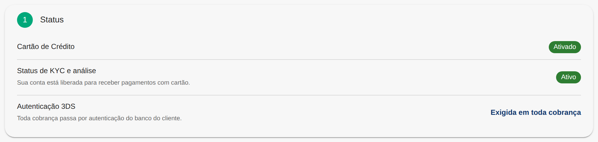
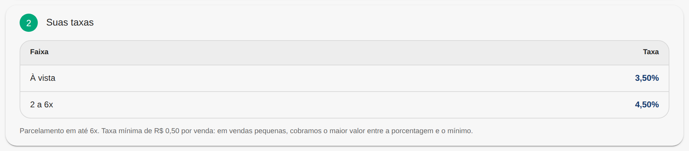
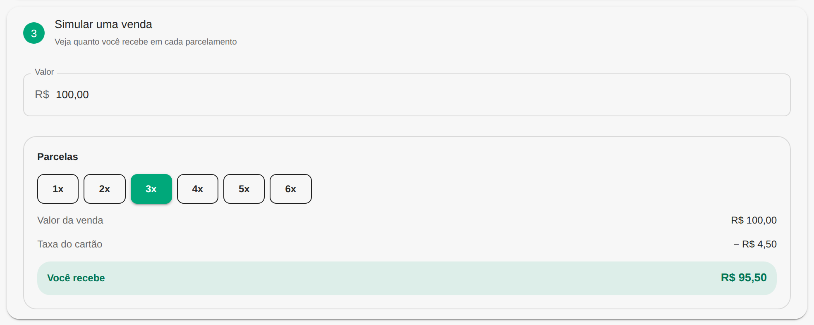
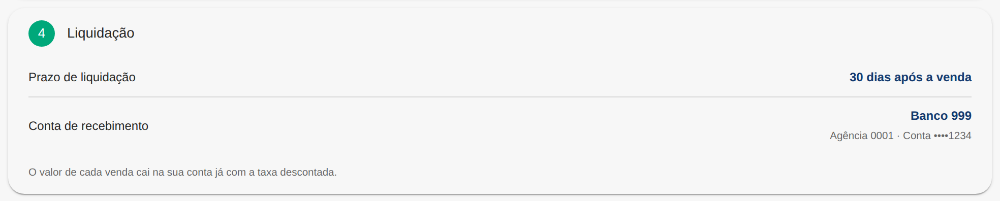
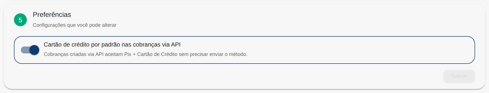

Para receber pagamentos com cartão de crédito, a sua conta passa por duas etapas: a habilitação pela Woovi e a aprovação do seu cadastro (KYC) pelo nosso parceiro de cartão.

- **KYC**: a análise do cadastro da sua conta pelo parceiro de cartão. A Woovi envia os dados da sua conta, você não precisa enviar nada.
- **3DS**: a autenticação do pagador no banco dele, por exemplo no aplicativo do banco, antes de aprovar o pagamento com cartão.
- **Liquidação**: o momento em que o valor da venda com cartão cai na sua conta.

## 1. Habilitação pela Woovi

Peça a habilitação do cartão de crédito ao nosso suporte, pelo chat da plataforma.

Depois da habilitação, a Woovi envia o seu cadastro para análise do parceiro de cartão.

## 2. Aprovação do cadastro (KYC)

O parceiro de cartão analisa o cadastro da sua conta. Você acompanha o andamento na plataforma, em **Cartão de Crédito** → **Ajustes**, no campo **Status de KYC e análise**:

| Status                  | O que significa                                    |
| ----------------------- | -------------------------------------------------- |
| **Esperando aprovação** | O seu cadastro está em análise.                    |
| **Ativo**               | A sua conta está liberada para receber com cartão. |

## 3. Comece a receber

Com o status **Ativo**, você já pode criar cobranças com cartão. Veja [Como criar uma cobrança com cartão de crédito pela API?](./card-how-to-create-charge-using-api.mdx)

:::caution Antes da aprovação
Enquanto o status não está **Ativo**, a cobrança é criada normalmente, mas o pagador não consegue pagar com cartão.
:::

:::info Parcelamento
O parcelamento no cartão está disponível por solicitação via chat pela plataforma. Ele vale para as cobranças criadas na plataforma, e a cobrança criada pela API é paga à vista. Saiba mais em [Parcelamento no cartão](./card-installments.md).
:::

## Ajustes do cartão

Em **Cartão de Crédito** → **Ajustes**, você acompanha a configuração do cartão na sua conta.

:::note
Os valores das imagens abaixo são ilustrativos.
:::

### Status



- **Cartão de Crédito**: **Ativado** quando o cartão está configurado na sua conta, ou **Não configurado**.
- **Status de KYC e análise**: o andamento do seu cadastro no parceiro de cartão.
- **Autenticação 3DS**: **Exigida em toda cobrança**. Todo pagamento com cartão passa por autenticação do banco do pagador.

### Suas taxas



A taxa de cada **Faixa** de parcelas, de **À vista** até o máximo de parcelas da sua conta. Abaixo da tabela aparece o máximo de parcelas e, quando existe, a taxa mínima por venda: em vendas pequenas, vale o maior valor entre o percentual e a taxa mínima.

Se as taxas ainda não foram configuradas, a tela mostra **Suas taxas de cartão ainda não foram configuradas. Fale com o suporte.**

### Simular uma venda



Digite o **Valor** e escolha o número de **Parcelas** para ver:

- **Valor da venda**: o valor da cobrança.
- **Taxa do cartão**: a taxa do número de parcelas escolhido. Se ela for menor que a taxa mínima da sua conta, vale a taxa mínima.
- **Você recebe**: o valor da venda menos a taxa. Quando a taxa é igual ou maior que o valor da venda, aparece **Abaixo da taxa mínima**.

### Liquidação



O valor de cada venda com cartão cai na sua conta de recebimento depois do prazo de liquidação da sua conta, contado a partir da data da venda, já com a taxa descontada.

- **Prazo de liquidação**: em quantos dias após a venda o valor cai na sua conta.
- **Conta de recebimento**: o banco, a agência e o final da conta que recebem as vendas com cartão. É a mesma conta da sua [chave Pix de saque](../faq/withdraw.md), cadastrada automaticamente quando o cartão é ativado na sua conta. O banco dessa conta precisa estar na lista de [bancos que podem receber as vendas com cartão](./card-settlement-banks.md).

:::info
Status, taxas e liquidação são definidos pela Woovi. Para alterar, fale com o suporte.
:::

### Preferências



As configurações que você mesmo pode alterar. Depois de mudar, clique em **Salvar**.

- **Cartão de crédito por padrão nas cobranças via API**: ativada, a cobrança criada pela API sem o campo `type` aceita Pix e cartão de crédito. Saiba mais em [Como aceitar cartão de crédito por padrão nas cobranças via API?](./card-api-charge-card-default.md)

## Exemplo: da cobrança ao pagamento

:::note Para quem faz a integração
Esta seção mostra as chamadas de API para receber com cartão. Se outra pessoa cuida da sua integração, envie esta página para ela.
:::

### 1. Crie a cobrança

```bash
curl 'https://api.woovi.com/api/v1/charge' -X POST \
    -H "Authorization: {APP_ID}" \
    -H "Content-Type: application/json" \
    --data-binary '{"correlationID":"c782e0ac-833d-4a89-9e73-9b60b2b41d3a","value":15000,"type":"PIX_CREDIT","customer":{"name":"Dan Silva","taxID":"31324227036","email":"dan@woovi.com"}}'
```

Com `type` `PIX_CREDIT`, o pagador escolhe entre Pix e cartão. Para aceitar somente cartão, use `CREDIT_CARD`.

### 2. Gere a página de pagamento com cartão

Envie o `paymentLinkUrl` da cobrança para o pagador, ou, se você tem um checkout próprio, gere a página de pagamento com cartão:

```bash
curl 'https://api.woovi.com/api/v1/charge/c782e0ac-833d-4a89-9e73-9b60b2b41d3a/card/smartform' -X POST \
    -H "Authorization: {APP_ID}"
```

```json
{
  "checkoutUrl": "https://..."
}
```

Redirecione o pagador para o `checkoutUrl`.

### 3. Confirme o pagamento

```bash
curl 'https://api.woovi.com/api/v1/charge/c782e0ac-833d-4a89-9e73-9b60b2b41d3a' \
    -H "Authorization: {APP_ID}"
```

Quando o pagamento com cartão é aprovado, o campo `charge.status` da resposta fica `COMPLETED`.

Os erros de quando a conta ainda não está pronta estão em [Como criar uma cobrança com cartão de crédito pela API?](./card-how-to-create-charge-using-api.mdx#erros-enquanto-a-conta-não-está-pronta)
