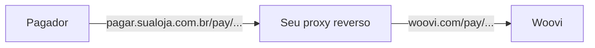

Por padrão, o link de pagamento de uma cobrança fica em `https://woovi.com/pay/{paymentLinkID}`.
Se você quer que o seu cliente veja um endereço da sua marca, como `https://pagar.sualoja.com.br/pay/{paymentLinkID}`,
basta colocar um **proxy reverso na sua própria infraestrutura** apontando para a Woovi.

Você não precisa de acesso à infraestrutura da Woovi nem de nenhuma configuração na plataforma.
A página de pagamento continua sendo a da Woovi; só o endereço muda.



Tudo o que a página de pagamento precisa fica sob o caminho `/pay`: o HTML, os scripts, os ícones
e a API que a página consulta (`/pay/graphql`). Por isso o proxy só precisa encaminhar esse caminho,
e `/receipts` se você também quiser servir os comprovantes. O resto do seu domínio continua livre.

## Pré-requisitos

- Um domínio ou subdomínio seu, por exemplo `pagar.sualoja.com.br`;
- Um certificado TLS válido para esse domínio (Let's Encrypt, por exemplo);
- Um proxy reverso: nginx, Caddy, Traefik, Cloudflare, o load balancer da sua nuvem etc.

## Configurando o proxy

Independente da ferramenta, o proxy precisa:

1. Encaminhar `/pay/` e `/receipts/` para `https://woovi.com`, preservando o caminho e a query string;
2. Enviar o cabeçalho `Host: woovi.com` e usar `woovi.com` como SNI na conexão TLS. Sem isso a requisição é recusada;
3. Aceitar `GET` e `POST` (a página faz `POST` em `/pay/graphql`);
4. **Não alterar nem fazer cache** das respostas. O HTML contém o QR Code e o código Pix Copia e Cola da cobrança.

### nginx

```nginx
server {
  listen 443 ssl http2;
  server_name pagar.sualoja.com.br;

  ssl_certificate     /etc/ssl/pagar.sualoja.com.br/fullchain.pem;
  ssl_certificate_key /etc/ssl/pagar.sualoja.com.br/privkey.pem;

  # página de pagamento, scripts, ícones, API da página e comprovantes
  location ~ ^/(pay|receipts)/ {
    proxy_pass https://woovi.com;
    proxy_ssl_server_name on;
    proxy_ssl_name woovi.com;

    proxy_set_header Host woovi.com;
    proxy_set_header X-Forwarded-Host $host;
    proxy_set_header X-Forwarded-For $proxy_add_x_forwarded_for;
    proxy_set_header X-Forwarded-Proto https;
  }
}
```

### Caddy

```caddy
pagar.sualoja.com.br {
  @woovi path /pay/* /receipts/*
  reverse_proxy @woovi https://woovi.com {
    header_up Host woovi.com
  }
}
```

O Caddy emite o certificado TLS automaticamente.

## Enviando o link com o seu domínio

A API continua devolvendo o `paymentLinkUrl` com o domínio da Woovi. Monte o link no seu domínio
a partir do `paymentLinkID`, que não muda:

```js
const MY_PAYMENT_DOMAIN = 'https://pagar.sualoja.com.br';

const { charge } = await response.json(); // resposta de POST /api/v1/charge

const myPaymentLinkUrl = `${MY_PAYMENT_DOMAIN}/pay/${charge.paymentLinkID}`;
```

O comprovante segue a mesma regra: `https://pagar.sualoja.com.br/receipts/{paymentLinkID}`.

## Testando

1. Crie uma cobrança e copie o `paymentLinkID`;
2. Abra `https://pagar.sualoja.com.br/pay/{paymentLinkID}` no navegador. O valor, o QR Code e o botão de copiar o código Pix devem aparecer;
3. Confira que a API da página responde pelo seu domínio:

```bash
curl -s -X POST https://pagar.sualoja.com.br/pay/graphql \
  -H 'content-type: application/json' \
  -d '{"query":"{ __typename }"}'
# {"data":{"__typename":"Query"}}
```

4. Pague a cobrança e veja a página mudar para "pago" sem recarregar.

## Limitações

- **Confirmação em tempo real**: a página abre um WebSocket direto com `wss://woovi.com` para mostrar o pagamento confirmado.
  Essa conexão não passa pelo seu proxy e não precisa de configuração. Se o seu domínio define uma Content Security Policy,
  libere `wss://woovi.com` em `connect-src`.
- **Imagens**: logos e imagens continuam vindo de `img.woovi.com`.
- **Pré-visualização**: ao compartilhar o link no WhatsApp ou em redes sociais, a pré-visualização ainda aponta para `woovi.com`.
- **Notificações da Woovi**: e-mails e mensagens enviados pela própria Woovi usam `woovi.com/pay/...`.
  Para o pagador receber só o link do seu domínio, envie a notificação pelo seu sistema.
- **Visual**: a página mantém a identidade visual da Woovi.
- **Volume**: todo o tráfego chega à Woovi a partir do IP do seu proxy. Se você espera muitos acessos, fale com o nosso suporte antes de ir para produção.

## Segurança

O proxy fica entre o pagador e a Woovi e pode ver e alterar a página, inclusive o QR Code.
Trate-o com o mesmo cuidado do seu próprio site:

- Use HTTPS do pagador até o proxy e do proxy até a Woovi;
- Não reescreva, injete nem faça cache do conteúdo devolvido pela Woovi;
- Restrinja quem pode alterar a configuração do proxy e o DNS desse domínio.
