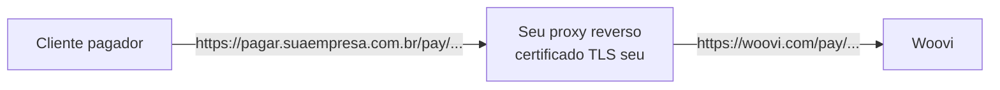

Por padrão, o link de pagamento de uma cobrança fica em `https://woovi.com/pay/{paymentLinkID}`.
Se você quer que o seu cliente pague em um endereço da sua marca, como
`https://pagar.suaempresa.com.br/pay/{paymentLinkID}`, basta configurar um **proxy reverso**
na sua própria infraestrutura apontando para a Woovi.

Você não precisa de acesso à infraestrutura da Woovi nem de nenhuma configuração na sua conta.
A página continua sendo a mesma da Woovi, apenas servida a partir do seu domínio.



## Pré-requisitos

- Um **subdomínio dedicado** ao link de pagamento, por exemplo `pagar.suaempresa.com.br`;
- Um **certificado TLS** válido para esse subdomínio (Let's Encrypt, por exemplo);
- Um servidor ou serviço capaz de atuar como proxy reverso (nginx, Caddy, Traefik, load balancer da sua nuvem, etc.).

:::tip
Use um subdomínio exclusivo para o link de pagamento. A página carrega seus arquivos
(JavaScript, CSS e imagens) a partir da raiz do domínio, então todo o tráfego do subdomínio
precisa ser encaminhado para a Woovi, e não apenas o caminho `/pay`.
:::

## Regras do proxy

Independente da ferramenta que você usar, o proxy precisa:

1. Encaminhar **todos os caminhos** do subdomínio para `https://woovi.com`, preservando o caminho e a query string;
2. Enviar o cabeçalho `Host: woovi.com` e usar `woovi.com` como SNI na conexão TLS;
3. Enviar o domínio original em `X-Forwarded-Host`;
4. Aceitar requisições `GET` e `POST` (a página faz chamadas `POST` em `/pay/graphql`);
5. **Não alterar** o conteúdo das respostas. O HTML contém o QR Code e o código Pix copia e cola da cobrança.

## Exemplo com nginx

```nginx
server {
  listen 443 ssl http2;
  server_name pagar.suaempresa.com.br;

  ssl_certificate     /etc/ssl/pagar.suaempresa.com.br/fullchain.pem;
  ssl_certificate_key /etc/ssl/pagar.suaempresa.com.br/privkey.pem;

  location / {
    proxy_pass https://woovi.com;
    proxy_ssl_server_name on;
    proxy_ssl_name woovi.com;

    proxy_set_header Host woovi.com;
    proxy_set_header X-Forwarded-Host $host;
    proxy_set_header X-Forwarded-For $proxy_add_x_forwarded_for;
    proxy_set_header X-Forwarded-Proto https;

    # redirecionamentos da Woovi continuam no seu domínio
    proxy_redirect https://woovi.com/ /;
  }

  # não faça cache das respostas da API da página
  location /pay/graphql {
    proxy_pass https://woovi.com;
    proxy_ssl_server_name on;
    proxy_ssl_name woovi.com;
    proxy_set_header Host woovi.com;
    proxy_set_header X-Forwarded-Host $host;
    proxy_set_header X-Forwarded-For $proxy_add_x_forwarded_for;
    proxy_no_cache 1;
    proxy_cache_bypass 1;
  }
}

server {
  listen 80;
  server_name pagar.suaempresa.com.br;
  return 301 https://$host$request_uri;
}
```

## Montando o link no seu domínio

As respostas da API continuam retornando o campo `paymentLinkUrl` com o domínio da Woovi.
Para enviar o link no seu domínio, troque apenas o domínio e mantenha o caminho
`/pay/{paymentLinkID}`:

```js
const MY_PAYMENT_DOMAIN = 'https://pagar.suaempresa.com.br';

const { charge } = await response.json(); // resposta de POST /api/v1/charge

const myPaymentLinkUrl = `${MY_PAYMENT_DOMAIN}/pay/${charge.paymentLinkID}`;
```

O mesmo vale para o comprovante: `https://woovi.com/receipts/{paymentLinkID}` fica disponível em
`https://pagar.suaempresa.com.br/receipts/{paymentLinkID}`.

## Validando

1. Crie uma cobrança e copie o `paymentLinkID`;
2. Abra `https://pagar.suaempresa.com.br/pay/{paymentLinkID}` no navegador;
3. Confira se a página exibe o valor, o QR Code e o botão de copiar o código Pix;
4. Nas ferramentas de desenvolvedor do navegador (aba **Rede**), confira se não há requisições
   com erro para o seu domínio.

## Limitações

- **Confirmação de pagamento em tempo real**: a página abre um WebSocket direto com
  `wss://woovi.com/pay/graphql/ws` para mostrar o pagamento confirmado sem recarregar.
  Essa conexão não passa pelo seu proxy. Se o seu domínio define uma Content Security Policy,
  libere `wss://woovi.com` em `connect-src`.
- **Imagens**: logos e imagens continuam sendo carregados de `img.woovi.com`.
- **Pré-visualização em redes sociais**: ao compartilhar o link no WhatsApp ou em redes sociais,
  a pré-visualização ainda aponta para `woovi.com`.
- **Notificações da Woovi**: e-mails e mensagens enviados pela própria Woovi usam o link
  `woovi.com/pay/...`. Se você quer que o cliente receba apenas o link do seu domínio,
  envie a notificação pelo seu sistema usando o link montado acima.

## Segurança

O proxy fica entre o seu cliente e a página de pagamento, então ele tem o mesmo nível de
responsabilidade que o seu próprio site:

- Use sempre HTTPS, tanto do cliente para o seu proxy quanto do seu proxy para a Woovi;
- Não reescreva, injete ou faça cache do HTML da página. Um proxy comprometido poderia trocar o QR Code;
- Restrinja quem pode alterar a configuração do proxy e do DNS desse subdomínio.
