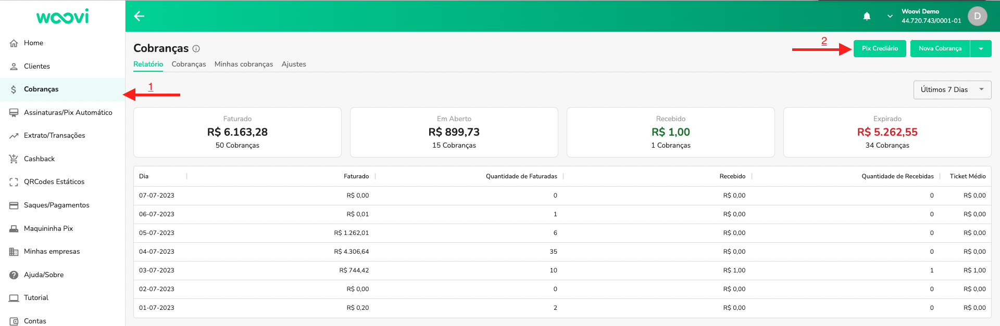
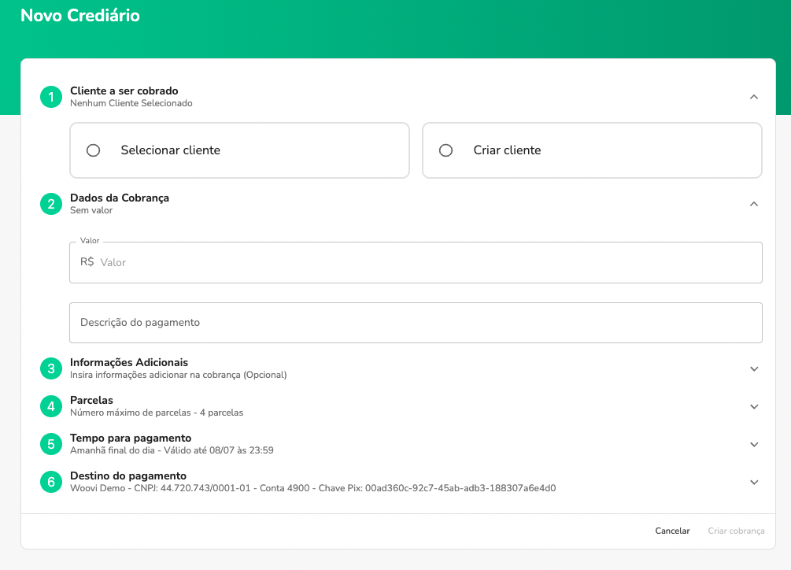
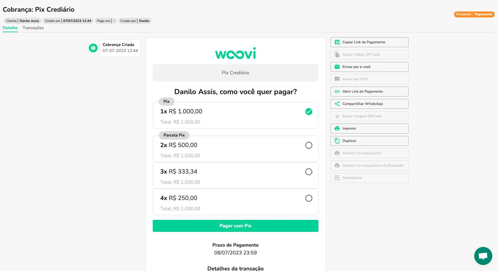
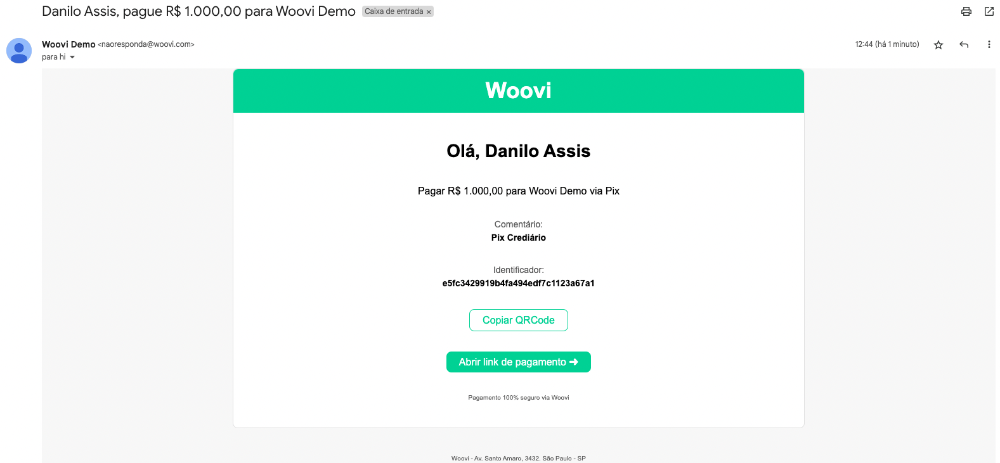
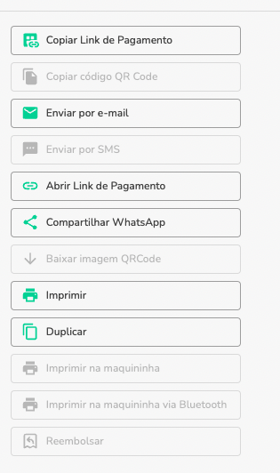
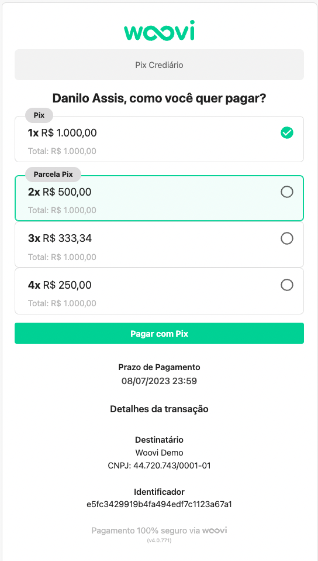
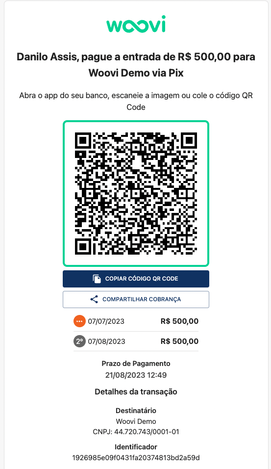
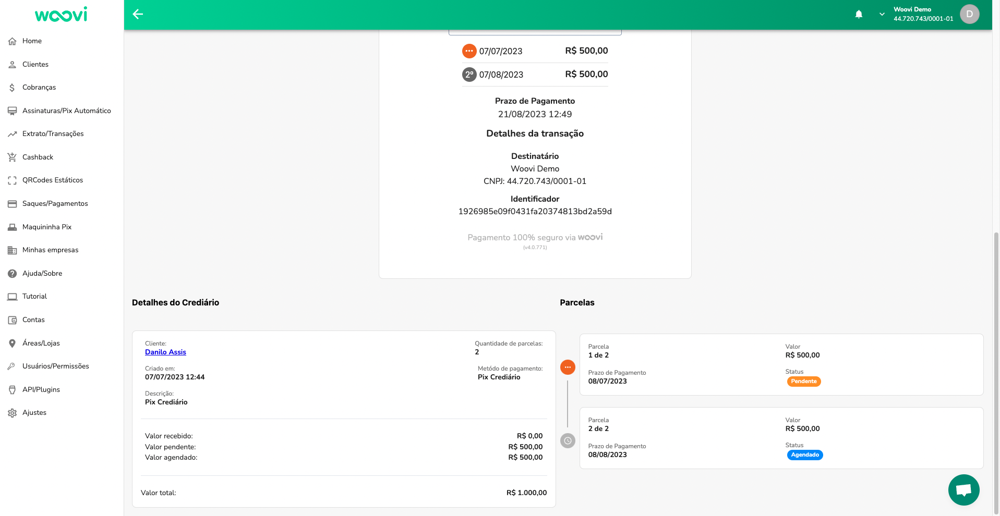

## Como funciona o Crediário Woovi?
O Crediário Woovi é uma ferramenta de gestão de crediário digital. Primeiramente, o lojista seleciona ou cadastra o cliente, definindo o valor da venda e as condições de pagamento. Em seguida, um link de pagamento é gerado e enviado ao cliente. Ele escolhe o número de parcelas e paga a primeira. Pronto, venda concluída

- Você define as regras
- Flexibildadade para o Cliente
- Rápido e Prático
- Acesso para vendedores
- Envio por email
- Envio por WhatsApp
- Análise de Crédito
- Acordo para Clientes Inadimplentes
- Dashboard e Relatórios

## Como usar o Crediário Woovi
1. Va até a sidebar e selecione Cobranças
2. Em Cobranças, no canto superior direito, clique no botão de acesso ao crediário
    
3. Em seguida preencha o formulário para criação do Crediário Woovi
   
   1. **Cliente a ser cobrado**: obrigatório o preenchimento de um cliente com nome, cpf/cnpj, telefone e email.
   2. **Dados da cobrança**: informe o valor do Crediário Woovi (obrigatório) e uma descriçao (opcional).
   3. **Informações Adicionais**: adicione informações adicionais ao Crediário Woovi (opcional).
   4. **Parcelas**: Selecione o número máximo de parcelas disponíveis para o cliente selecionar no momento do pagamento. Padrão 4 parcelas.
   5. **Tempo para pagamento**: tempo para pagamento da primeira parcela. Padrão final do dia seguinte.
   6. **Destino do pagamento**: conta que irá receber o pagamento das parcelas do Crediário Woovi.
4. Preenche o formulário como desejar e clique em **Criar Cobrança**
5. Ao cria-lo você será redirecionado para o detalhe do Crediário Woovi.
   
6. Uma vez criado o mesmo é enviado via email para seu cliente
   
7. Você pode executar ações de mensageria dentro da plataforma através dos botões existentes no detalhe da cobrança
   
8. Quando seu cliente abrir o link de pagamento ele poderá selecionar a opção desejada de pagamento
   
9. Ao selecionar a opção será disponibilizado o QRCode Pix da primeira parcela junto com suas informações
   
10. Ao selecionar a forma de pagamento você poderá acompanhar as parcelas do Crediário Woovi dentro do próprio detalhe da plataforma. Basta descer a página e acompanhar as parcelas:
    