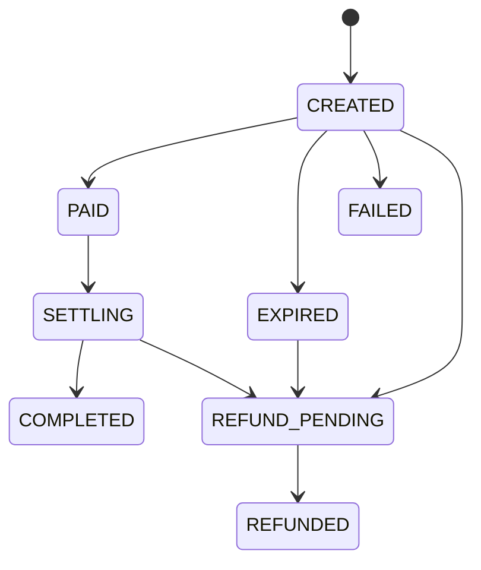

O fluxo tem quatro passos:

1. **Cotar** o total que o pagador vai pagar.
2. **Criar o pagamento** (_payment-in_) e receber o QR Code Pix.
3. **Mostrar o Pix** ao pagador.
4. **Consultar o status** até `COMPLETED`, quando o valor foi liquidado na sua CNR.

Antes de começar, confira os [requisitos](./efx-requirements.mdx). Todos os valores são **em centavos de real** (`50000` = R$ 500,00). Os exemplos usam dados fictícios.

## 1. Cotar

```bash
curl --request GET \
  --url 'https://api.woovi.com/api/v1/efx/quote?value=50000&currency=BRL&purpose=SERVICE_PURCHASE' \
  --header 'Authorization: <SEU_APPID>'
```

Resposta `200`:

```json
{
  "quote": {
    "purpose": "SERVICE_PURCHASE",
    "value": 50000,
    "currency": "BRL",
    "iof": { "rate": 0, "value": 0 },
    "fee": { "value": 500 },
    "totalValue": 50500,
    "expiresAt": "2026-10-13T15:05:00.000Z"
  }
}
```

A cotação **não cria** nada. Use o `totalValue` para mostrar ao pagador quanto ele vai pagar: o `value` que chega na sua CNR, mais o IOF (`iof.value`) e a tarifa da Woovi (`fee.value`). Sempre use os valores devolvidos pela API, sem recalcular do seu lado.

O `expiresAt` da cotação indica até quando ela vale como referência. O preço só fica travado quando você cria o pagamento.

## 2. Criar o pagamento

```bash
curl --request POST \
  --url https://api.woovi.com/api/v1/efx/payment-in \
  --header 'Authorization: <SEU_APPID>' \
  --header 'Content-Type: application/json' \
  --data-raw '{
    "correlationID": "order-7f3a91",
    "value": 50000,
    "currency": "BRL",
    "purpose": "SERVICE_PURCHASE",
    "expectedTotalValue": 50500,
    "description": "Assinatura anual",
    "expiresIn": 900,
    "payer": {
      "name": "Maria Silva",
      "taxID": "529.982.247-25",
      "email": "maria@example.com"
    },
    "beneficiary": {
      "name": "Example Payments Ltd.",
      "country": "US",
      "type": "COMPANY",
      "taxID": "12.345.678/0001-90",
      "bankAccount": {
        "ispb": "12345678",
        "branch": "0001",
        "accountNumber": "1234567",
        "accountType": "CHECKING"
      }
    },
    "invoice": {
      "number": "INV-2026-000123",
      "issuedAt": "2026-10-13T14:55:00.000Z",
      "url": "https://example.com/invoices/INV-2026-000123.pdf"
    }
  }'
```

- `beneficiary.bankAccount` é a sua CNR, cadastrada na Woovi.
- `payer.taxID` é o CPF ou CNPJ do seu cliente. O Pix tem que sair de uma conta no nome dele.
- `expectedTotalValue` é opcional: se o total calculado na criação for outro, nada é criado e a resposta é `409 quote changed: totalValue is now <valor>`. Use para garantir que o pagador paga exatamente o que você mostrou.

Todos os campos estão na [referência da API](./efx-api-reference.mdx#criar-um-pagamento).

Resposta `201`:

```json
{
  "paymentIn": {
    "id": "6a0c3f2e9b1d4c0012ab34cd",
    "correlationID": "order-7f3a91",
    "status": "CREATED",
    "purpose": "SERVICE_PURCHASE",
    "value": 50000,
    "currency": "BRL",
    "iof": { "rate": 0, "value": 0 },
    "fee": { "value": 500 },
    "totalValue": 50500,
    "payer": { "name": "Maria Silva", "taxID": "52998224725" },
    "beneficiary": { "name": "Example Payments Ltd.", "country": "US" },
    "pix": {
      "brCode": "00020101021226...6304ABCD",
      "qrCodeImage": "https://.../qrcode.png",
      "paymentLinkUrl": "https://..."
    },
    "expiresAt": "2026-10-13T15:15:00.000Z",
    "createdAt": "2026-10-13T15:00:00.000Z"
  }
}
```

O total do Pix é o `totalValue`, travado na criação até o `expiresAt`.

## 3. Mostrar o Pix ao pagador

Escolha uma forma:

- gere o QR Code a partir do `pix.brCode`, ou ofereça o Pix copia e cola com ele;
- mostre a imagem de `pix.qrCodeImage`;
- envie o pagador para o `pix.paymentLinkUrl`.

Avise o pagador de que o Pix tem que sair de uma conta **no nome dele**, com o mesmo CPF ou CNPJ informado. Um Pix pago por outra pessoa é devolvido, não liquidado.

## 4. Consultar o status

```bash
curl --request GET \
  --url https://api.woovi.com/api/v1/efx/payment-in/order-7f3a91 \
  --header 'Authorization: <SEU_APPID>'
```

O `:id` aceita o `id` do pagamento ou o seu `correlationID`. Não há webhooks de eFX: consulte o pagamento (ou a [listagem](./efx-api-reference.mdx#listar-pagamentos)) até um status final. O status não muda no instante do Pix: a confirmação e a liquidação são processadas em segundo plano.

```json
{
  "paymentIn": {
    "id": "6a0c3f2e9b1d4c0012ab34cd",
    "correlationID": "order-7f3a91",
    "status": "COMPLETED",
    "value": 50000,
    "totalValue": 50500,
    "paidAt": "2026-10-13T15:03:12.000Z",
    "endToEndId": "E12345678202610131503abcdef123456",
    "settledAt": "2026-10-13T15:05:01.000Z",
    "...": "..."
  }
}
```

## Status



| Status | Significado | Final? |
| --- | --- | --- |
| `CREATED` | Pix criado, aguardando o pagamento. | não |
| `PAID` | Pix recebido e conferido: pagador, valor e prazo batem. A liquidação vai começar. | não |
| `SETTLING` | Transferência do `value` para a sua CNR em andamento. | não |
| `COMPLETED` | `value` liquidado na sua CNR (`settledAt`). | sim |
| `EXPIRED` | Ninguém pagou até o `expiresAt`. | sim, salvo um Pix pago depois do prazo (vai para `REFUND_PENDING`) |
| `REFUND_PENDING` | O Pix foi recebido, mas tem que voltar ao pagador e não será liquidado. O motivo está em `refund.reason`. | não |
| `REFUNDED` | Devolução concluída. `refund.endToEndId` identifica o Pix de devolução. | sim |
| `FAILED` | O Pix não pôde ser criado. Crie outro pagamento com um `correlationID` novo. | sim |

Veja os motivos de devolução em [Devoluções](./efx-refunds.mdx).

## Idempotência pelo `correlationID`

O `correlationID` identifica **um** pagamento da sua empresa.

- Repetir o `POST` com o mesmo `correlationID` e o **mesmo corpo** responde `200` com o mesmo pagamento e o mesmo Pix, sem criar outro. A ordem dos campos não importa, e o `expectedTotalValue` não entra na comparação.
- O mesmo `correlationID` com um corpo **diferente** responde `409 correlationID already used with a different body`.
- Se a criação responder `502 could not create the Pix charge right now; retry with the same correlationID`, repita o mesmo `POST`: o pagamento já existe e a Woovi tenta criar o Pix de novo.
- Se responder `502 could not create the Pix charge; use a new correlationID to try again`, o pagamento ficou `FAILED`: crie outro com um `correlationID` novo.
