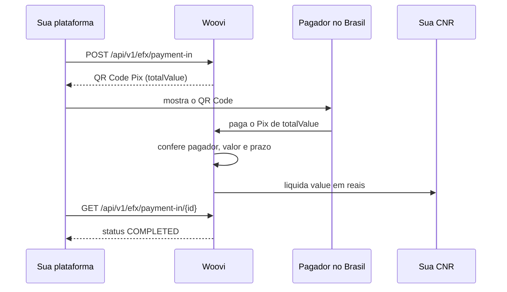

O **eFX da Woovi** é para plataformas de pagamento internacional (prestadoras de serviços de pagamento ou transferência internacional, as plataformas eFX) que precisam receber pagamentos de pessoas e empresas no Brasil.

O seu cliente no Brasil paga com **Pix**. A Woovi confere o pagamento e liquida o valor integral, **em reais**, na **conta em reais de não residente (CNR)** da sua plataforma. Você integra uma API REST: cria o pagamento, mostra o QR Code Pix ao pagador e acompanha o status até a liquidação.

## Como o dinheiro circula

1. Você informa o valor da operação (`value`), em centavos de real.
2. A Woovi calcula o IOF e a tarifa da Woovi e devolve o total a pagar (`totalValue = value + iof + fee`).
3. O pagador paga o `totalValue` por Pix, a partir de uma conta no próprio nome.
4. A Woovi liquida o `value` **integral** na sua CNR.

IOF e tarifa são cobrados **por fora** e pagos pelo pagador. Eles nunca são descontados do valor que chega na sua CNR: você recebe exatamente o `value` que informou ao criar o pagamento.

## Moeda

Hoje a liquidação é feita **somente em reais (`BRL`)**, na sua CNR. O pagamento é criado com `currency: "BRL"` e não envolve conversão de moeda na Woovi.

## O que está disponível

| Recurso | Situação |
| --- | --- |
| Cotação (`GET /api/v1/efx/quote`) | Disponível |
| Recebimento por Pix (_pay-in_): criar, consultar e listar | Disponível |
| Envio de pagamentos ao Brasil (_pay-out_) | **Ainda não disponível** |
| Webhooks de eFX | Ainda não disponíveis: acompanhe o status consultando a API |

## Próximos passos

- [Requisitos e regras](./efx-requirements.mdx): o que você precisa ter antes de integrar e as regras do Banco Central que valem para cada operação.
- [Guia de integração](./efx-getting-started.mdx): da cotação à liquidação, com exemplos.
- [Referência da API](./efx-api-reference.mdx): campos, status e erros de cada rota.
- [Devoluções](./efx-refunds.mdx): o que acontece com Pix de terceiros, pagos fora do prazo ou em duplicidade.
- [Reporte ao Banco Central](./efx-regulatory-reporting.mdx): como cada operação é informada ao Banco Central.
