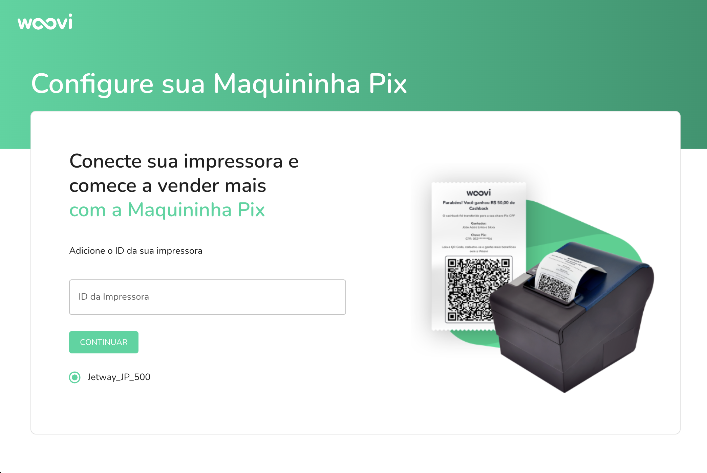
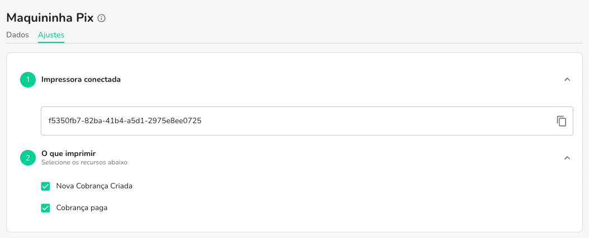
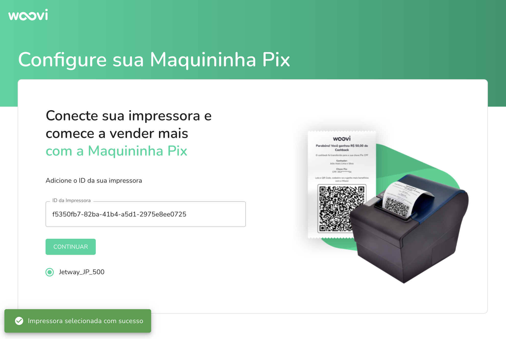

import Embed from 'react-embed';

:::info
É esperado que você já possua conta na Woovi. Caso não tenha, [clique aqui](https://ajuda.woovi.com/hc/duvidas-frequentes/articles/como-fazer-login-na-plataforma) para saber como criar uma conta.
:::

:::info
Para instalar a Maquininha Woovi, você precisa de uma impressora térmica conectada ao seu computador. Caso sua impressora térmica não esteja conectada, [clique aqui](setup-maquininha-woovi.md) para saber como conectar.
:::

## Sistemas operacionais suportados

A Maquininha Woovi imprime as cobranças e os recibos de pagamentos recebidos via Pix em uma impressora térmica. Há duas formas de imprimir:

| Forma de impressão | Como funciona | Sistemas operacionais |
| --- | --- | --- |
| **Impressão automática** | Aplicativo Maquininha Woovi para Windows + integração da impressora com filtros de impressão. | Somente Windows |
| **Impressão manual pelo navegador** | Botão **Imprimir na maquininha** na cobrança (impressora via USB). | Windows e macOS, nos navegadores Google Chrome, Edge ou Opera |
| **Impressão manual via Bluetooth** | Botão **Imprimir na maquininha via Bluetooth** na cobrança (Web Bluetooth), para impressoras Bluetooth Low Energy compatíveis. | Windows e macOS, nos navegadores Google Chrome, Edge ou Opera |

- **Linux:** não suportado.
- **Celular:** não suportado.

No Windows, instale o driver da sua impressora antes de imprimir. Veja [É necessário instalar algum driver?](./is-it-necessary-to-install-any-driver-to-print-a-charge.md).

## Como instalar a Maquininha Woovi (impressão automática no Windows)

Com a Maquininha Woovi você gera cobranças, imprime o QR Code Pix fisicamente para que seus clientes paguem via Pix e imprime o recibo quando o pagamento é confirmado.

Acesse o tutorial da Maquininha Woovi para instalar o nosso aplicativo: [https://app.woovi.com/home/pix-machine/tutorial](https://app.woovi.com/home/pix-machine/tutorial) e clique em `Download Windows`.

<Embed url='https://www.youtube.com/watch?v=UdehtJz3MVo'/>

Após baixar o arquivo, clique em `Abrir` e, em seguida, em `Executar`.

## Após instalar o aplicativo

Com o aplicativo instalado, será mostrado um ícone na área de trabalho. Clique duas vezes para abrir o aplicativo.

Com o aplicativo instalado, é necessário adicionar o ID da sua impressora térmica.

## Vinculando a impressora térmica

Com o aplicativo já instalado, acesse as configurações da Maquininha Woovi [clicando aqui](https://app.woovi.com/home/pix-machine/settings) ou em `Maquininha Woovi` > `Ajustes`, e copie o ID da impressora.

Com o ID da impressora copiado, abra o aplicativo da Maquininha Woovi, cole o ID no campo `ID da impressora` e clique em `Salvar`.

## Filtros de impressão automática

Na integração da impressora, escolha quais eventos devem ser impressos automaticamente:

- **Todas as cobranças criadas na plataforma:** imprime o QR Code Pix quando a cobrança é criada.
- **Todas as cobranças pagas na plataforma:** imprime o recibo quando a cobrança é paga.
- **Todos os QRCode estáticos pagos na plataforma:** imprime o recibo quando um QR Code estático é pago.

Veja os tutoriais [Como imprimir cobranças e recibos de pagamento](./how-to/maquininha-woovi-how-to-print-charge.md) e [Como imprimir o recibo de um QR Code estático](./how-to/maquininha-woovi-how-to-print-static-qr-code-receipt.md).

Pronto! Sua Maquininha Woovi está pronta para ser usada.

## Como testar se a Maquininha Woovi está funcionando

Para testar, crie uma cobrança qualquer na plataforma da Woovi (com o filtro **Todas as cobranças criadas na plataforma** habilitado) e veja se a impressão foi feita corretamente.
