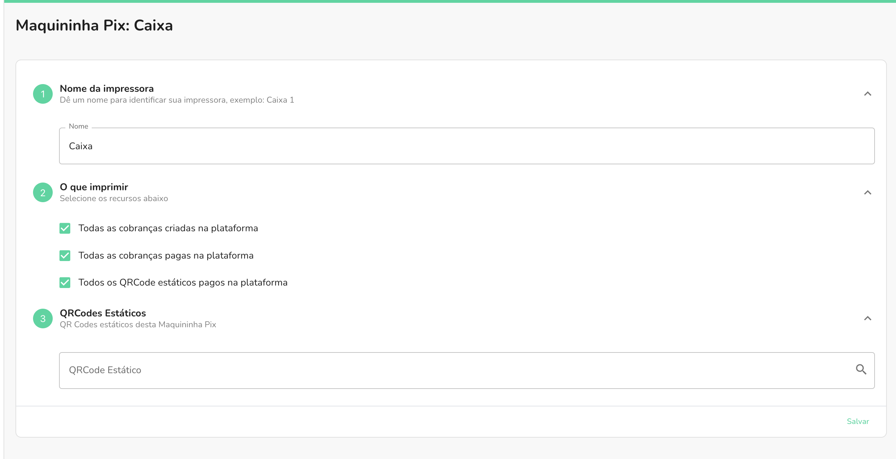

Com a Maquininha Woovi, você pode imprimir automaticamente tanto os QR Codes Pix das
cobranças quanto os recibos de pagamento delas.

Habilitando os filtros **Todas as cobranças criadas na plataforma** e
**Todas as cobranças pagas na plataforma** na sua integração, a Maquininha Woovi
imprimirá automaticamente os eventos conforme o nome descrito em cada filtro.

Com o filtro de cobranças criadas habilitado, toda cobrança criada na plataforma será impressa
automaticamente pela Maquininha Woovi. Com o filtro de cobranças pagas habilitado, o recibo de
cada pagamento dessas cobranças será impresso automaticamente.

:::info
A impressão automática exige o aplicativo Maquininha Woovi para Windows. Veja [Como instalar a Maquininha Woovi](../how-to-install-maquininha-woovi.md).
:::
