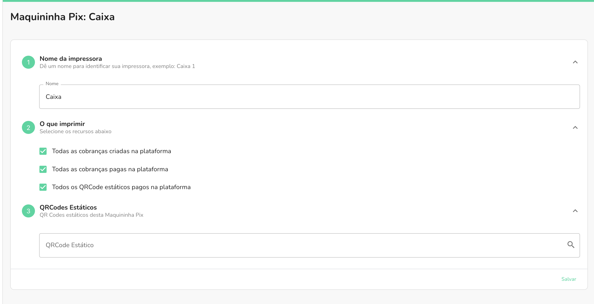
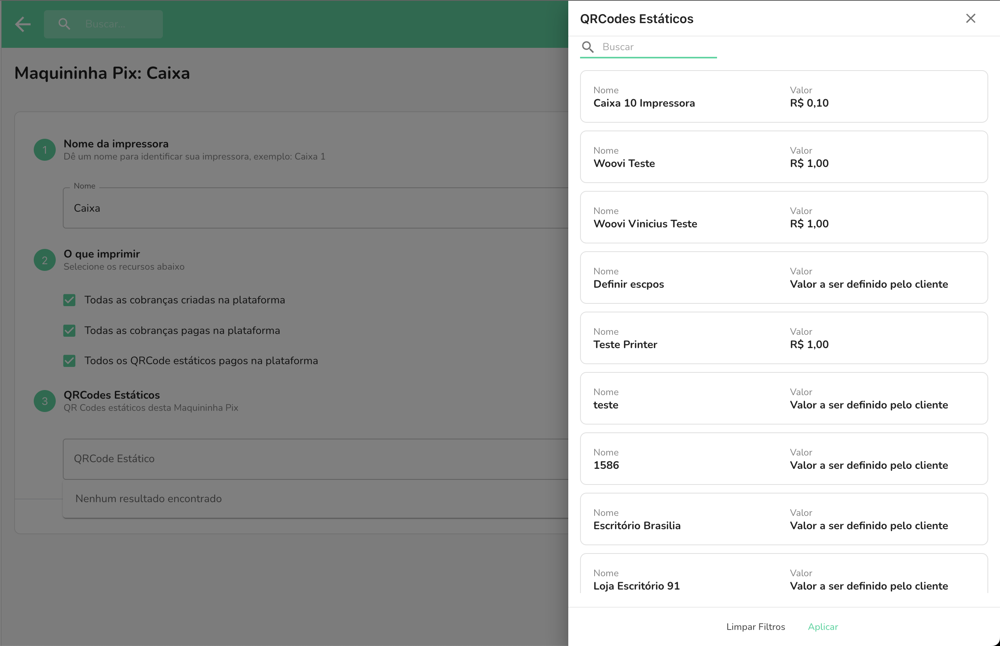

Com a Maquininha Woovi, você pode imprimir fisicamente os recibos
de pagamento de um ou mais QR Codes estáticos.

Há duas maneiras de imprimir os recibos de pagamento de QR Codes estáticos: imprimir os pagamentos de todos os QR Codes estáticos ou filtrar QR Codes estáticos específicos.

Caso deseje imprimir o recibo do pagamento de todos os QR Codes estáticos, basta selecionar a opção de **"Todos os QRCode estáticos pagos na plataforma"**.

## Filtrando os QR Codes estáticos

Caso deseje filtrar a impressão dos recibos de pagamento por QR Codes estáticos específicos,
a etapa de número 3 do formulário te dá essa possibilidade.

Ao clicar no campo de QR Codes estáticos, abrirá uma lista para você selecionar de quais QR Codes estáticos
deseja imprimir os eventos de pagamento.

:::info

Lembre-se de que é necessário desabilitar o filtro de **"Todos os QRCode estáticos pagos na plataforma"** para não haver nenhum conflito.

:::
