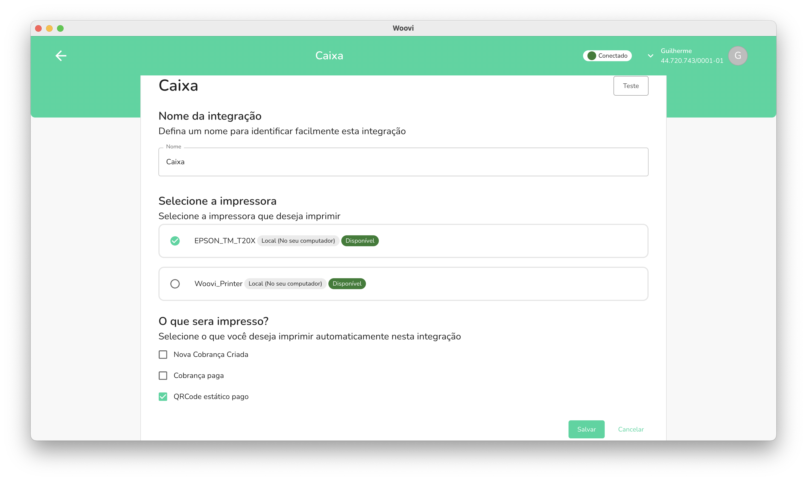

A Maquininha Woovi oferece para as pizzarias um meio automático, prático e fácil
de automatizar o fluxo de pagamentos via Pix no seu estabelecimento: você imprime o QR Code Pix
das cobranças e os recibos dos pagamentos em uma impressora térmica não fiscal.

## Como instalar a Maquininha Woovi no meu computador?

Para instalar o aplicativo da Maquininha Woovi no seu computador (Windows), siga o tutorial [Como instalar a Maquininha Woovi](./how-to-install-maquininha-woovi.md).

Esse tutorial mostra o passo a passo da instalação e da configuração inicial do aplicativo, além dos sistemas operacionais suportados.

## Como imprimir usando a Maquininha Woovi?

Com a Maquininha Woovi, você pode imprimir tanto os QR Codes Pix para pagamento,
quanto seus respectivos recibos confirmando o pagamento daquele QR code. Abaixo, temos um
tutorial explicando como realizar a impressão:

### Imprimindo o recibo de um QR code estático

Com o QR code estático, você consegue automatizar o seu processo de pagamento de forma fácil
e simplificada. Principalmente voltada para pizzarias com alta rotatividade de clientes, que
também fornecem o serviço no próprio estabelecimento, o QR code estático pode ser a maneira
mais prática de oferecer um método de pagamento Pix para os seus clientes.

Com um QR code estático criado a partir da nossa plataforma, você pode imprimi-lo e deixá-lo
visível fisicamente no seu caixa, em cada uma das mesas, ou até mesmo vindo
junto à comanda.

Na integração da impressora, dentro da Maquininha Woovi, é necessário que ela tenha o filtro de
**"QR code estático pago"** selecionado. Deste modo, quando o cliente realizar o pagamento daquele QR code
que você compartilhou, a Maquininha Woovi imprimirá automaticamente o recibo de pagamento contendo as
informações da transação.

### Imprimindo uma cobrança Pix

Com a cobrança Pix, você consegue operar de forma mais meticulosa cada uma das cobranças geradas,
tendo a possibilidade de selecionar o respectivo cliente, informações adicionais, e mais. Principalmente
voltada para pizzarias que fornecem seus serviços a partir de delivery, e que operam por meios digitais,
junto com a nossa solução de link de pagamento e a facilidade da cobrança via WhatsApp, pode ser o combinado
perfeito para alavancar ainda mais suas vendas.

Com as cobranças, você tem a possibilidade tanto de imprimir o respectivo QR code daquela cobrança, quanto
o seu recibo de pagamento.

Para a impressão do QR code de uma cobrança, a sua integração da Maquininha Woovi precisa ter o filtro de **"Cobrança criada"**
habilitado. Deste modo, conforme as cobranças vão sendo criadas a partir da nossa plataforma, a Maquininha Woovi
fará automaticamente a impressão na impressora selecionada na integração.

Para a impressão do recibo de pagamento de uma cobrança, a sua integração da Maquininha Woovi precisa ter o filtro de **"Cobrança paga"**
habilitado. Deste modo, assim que o cliente efetuar o pagamento do respectivo QR code daquela cobrança, a Maquininha Woovi
fará automaticamente a impressão na impressora selecionada na integração.
