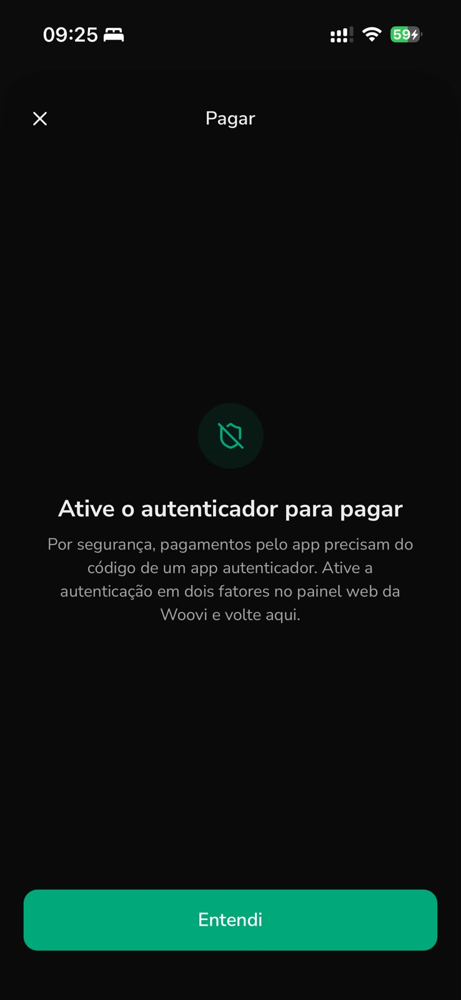
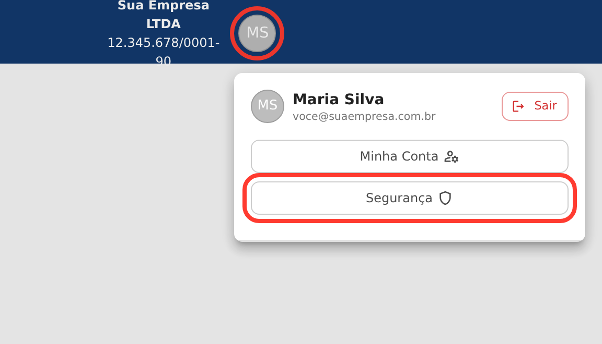
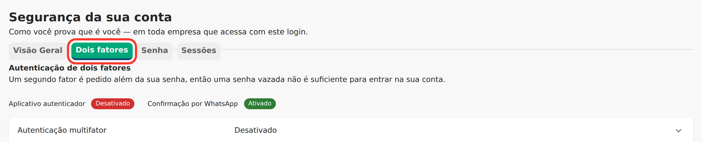
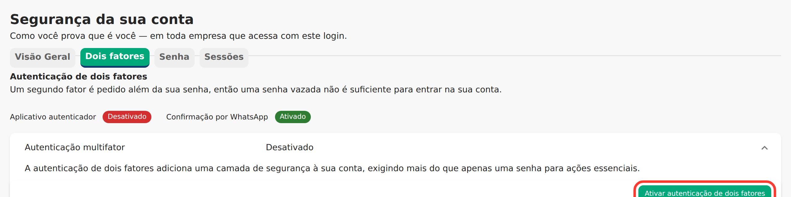
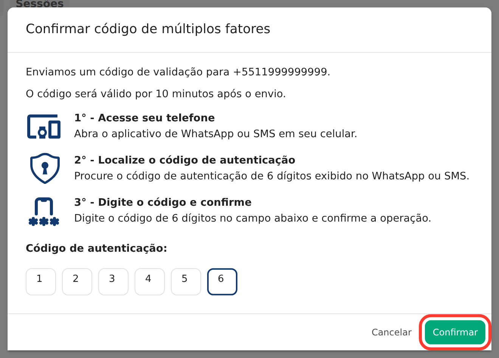
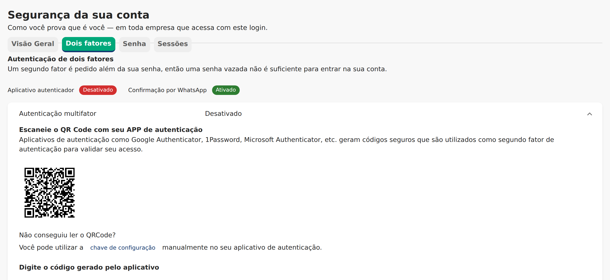
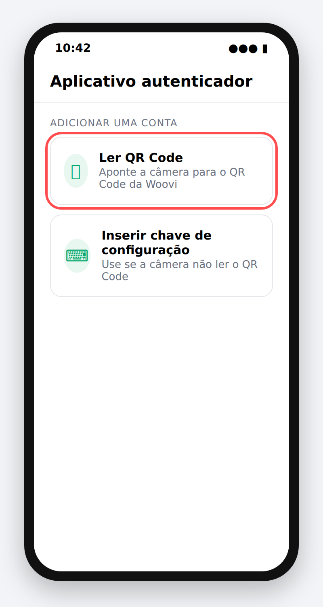
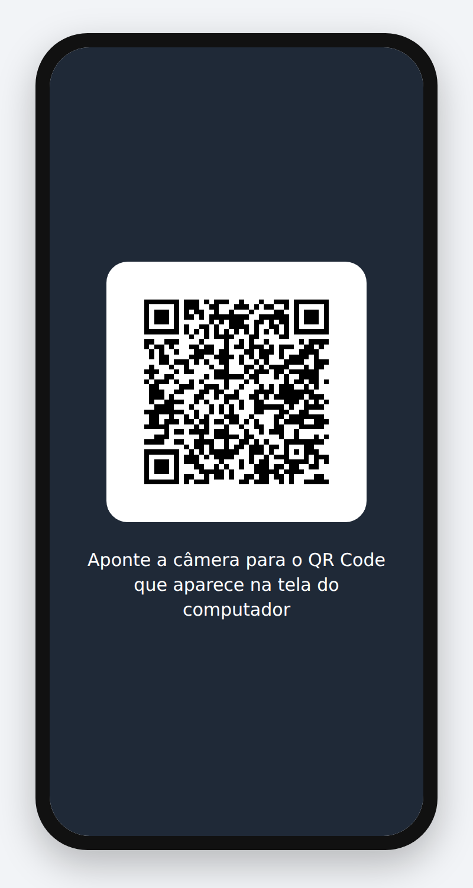
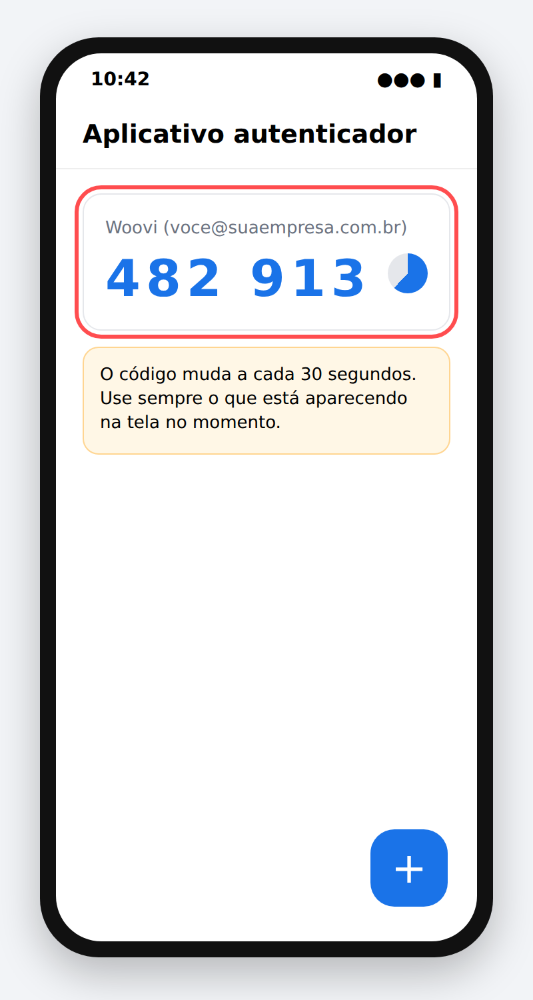
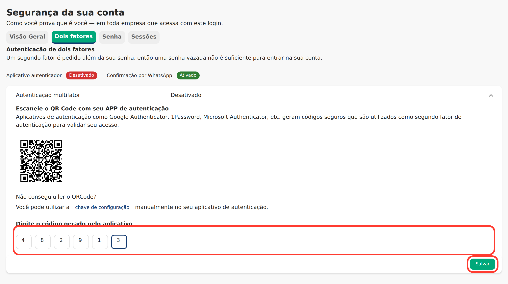

O aplicativo autenticador gera um código de 6 dígitos que muda a cada 30 segundos. Ele protege sua conta:
mesmo que alguém descubra sua senha, não consegue entrar nem movimentar dinheiro sem esse código.

Para fazer Pix e pagamentos pelo app da Woovi, o aplicativo autenticador é obrigatório. Se ele ainda não
estiver ativo, o app mostra a tela abaixo. O código do WhatsApp não vale para pagar pelo app.

A ativação é feita uma vez só por usuário.

:::info Antes de começar

- Instale um aplicativo autenticador no celular: Google Authenticator, Microsoft Authenticator, 1Password ou Authy, por exemplo.
- Tenha em mãos o WhatsApp do celular cadastrado na Woovi. Para confirmar que é você, enviamos um código para ele.
- Faça a ativação em dia útil, das 9h às 18h. Fora desse horário a ativação fica indisponível, por segurança.

:::

## Ativando a autenticação multi-fator

### 1. Abra o menu do seu usuário e clique em "Segurança"

Entre em [app.woovi.com](https://app.woovi.com) pelo navegador do computador e clique no seu nome ou na sua
foto, no canto superior direito. No menu que abrir, clique em **Segurança**.

### 2. Abra a aba "Dois fatores"

Na tela "Segurança da sua conta", clique na aba **Dois fatores**. Se preferir, use o
[link direto para a aba](https://app.woovi.com/home/me/security/tabs/two-factor).

Ali aparece "Aplicativo autenticador: **Desativado**". É isso que vamos ativar.

### 3. Clique em "Ativar autenticação de dois fatores"

Clique em **Autenticação multifator** para abrir o quadro e depois no botão **Ativar autenticação de dois fatores**.

### 4. Confirme com o código do WhatsApp

Enviamos um código de 6 dígitos para o WhatsApp do celular cadastrado. Digite o código e clique em
**Confirmar**. Ele vale por 10 minutos.

### 5. Um QR Code vai aparecer na tela

Deixe essa tela aberta no computador e pegue o celular.

### 6. Leia o QR Code com o aplicativo autenticador

No celular, abra o aplicativo autenticador e toque em adicionar conta (normalmente um botão **+**).
Escolha **Ler QR Code** e aponte a câmera para o QR Code do computador.

A conta **Woovi** aparece no aplicativo, com um código de 6 dígitos que muda a cada 30 segundos.

:::tip A câmera não leu o QR Code?

Na tela do computador, clique em **chave de configuração**, copie a chave e, no aplicativo autenticador,
escolha **Inserir chave de configuração** e cole.

:::

:::note

As telas do aplicativo autenticador mudam um pouco de um aplicativo para outro. As desta página são ilustrativas.

:::

### 7. Digite o código e clique em "Salvar"

Volte ao computador, digite no campo **Digite o código gerado pelo aplicativo** o código que está aparecendo
agora no aplicativo autenticador e clique em **Salvar**.

Pronto. O "Aplicativo autenticador" passa a aparecer como **Ativado**. A partir daí, ações sensíveis da
conta, como Pix, pagamentos e saques, pedem o código do aplicativo autenticador.

## Fazendo Pix pelo app da Woovi

Volte ao app da Woovi e faça o Pix ou o pagamento normalmente. Quando o app pedir o código, abra o aplicativo
autenticador e digite o código que está aparecendo para a conta Woovi.

## Trocando de celular

O código fica no aplicativo autenticador do celular antigo. Com ele ainda em mãos, desative o autenticador
(veja abaixo) e ative de novo, lendo o QR Code com o celular novo. Se já não tem o celular antigo, fale com
o suporte pelo chat.

## Desativando a autenticação multi-fator

1. Abra a aba **Dois fatores** em **Segurança**, como nos passos 1 e 2.
2. Clique em **Autenticação multifator** e depois em **Desativar**.
3. Digite o código de confirmação que enviamos e confirme.

:::caution

Sem o aplicativo autenticador, você não consegue fazer Pix e pagamentos pelo app da Woovi. Se desativar,
ative de novo assim que puder.

:::

## Dúvidas comuns

**O código diz que é inválido.** Use sempre o código que está na tela no momento, porque ele muda a cada
30 segundos. Se continuar inválido, confira se a data e a hora do celular estão no automático: o código
depende do horário certo.

**Apareceu que a ação só é permitida em horário comercial.** A ativação funciona em dias úteis, das 9h às 18h.
Tente de novo nesse horário.

**Cada pessoa da empresa precisa ativar?** Sim. O aplicativo autenticador é de cada usuário, não da empresa.
Cada pessoa que faz Pix ou pagamentos ativa o seu, no próprio login. Para exigir isso de todos os usuários da
empresa, veja [Autenticação de múltiplos fatores em empresas](https://ajuda.woovi.com/hc/duvidas-frequentes/articles/1770645121-autenticacao-de-dois-fatores-para-empresas).
