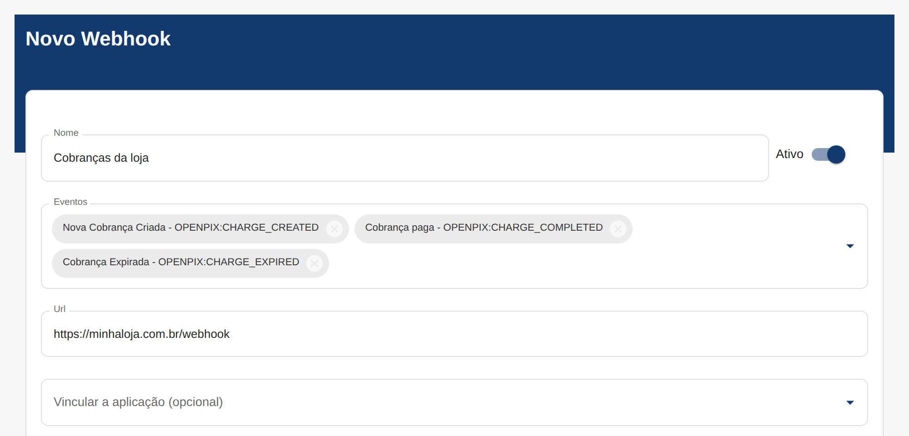
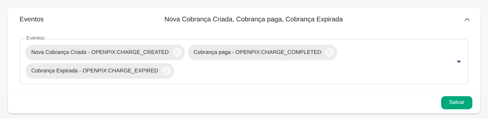

Um webhook pode ouvir mais de um evento. Você cadastra a URL uma vez e escolhe todos os eventos que ela deve receber, em vez de criar um webhook por evento.

Use quando o mesmo endpoint trata vários eventos, por exemplo a cobrança criada, paga e expirada da sua loja.

## Como cada evento chega

- Cada evento é enviado em uma chamada separada para a sua URL.
- O campo `event` do corpo diz qual evento disparou a chamada. Use esse campo para saber o que fazer com ela.

```json
{
  "event": "OPENPIX:CHARGE_COMPLETED",
  "charge": {}
}
```

Veja o corpo de cada evento em [Exemplos de payload do Webhook](/docs/category/exemplos).

## Pela plataforma

1. Acesse **API/Plugins** no menu lateral.
2. Clique em **Novo Webhook**.
3. Preencha o **Nome** e a **Url**.
4. No campo **Eventos**, escolha todos os eventos que o webhook deve receber.
5. Clique em **Salvar**.



O primeiro evento escolhido fica como o evento principal do webhook.

:::info
Se o formulário mostra o campo **Evento**, no singular, a sua conta ainda não tem vários eventos por webhook. Fale com o suporte.
:::

### Mudar os eventos de um webhook que já existe

1. Acesse **API/Plugins** e clique no webhook na lista.
2. Na aba **Dados**, abra **Eventos**.
3. Adicione ou remova eventos e clique em **Salvar**.



Para salvar, o seu usuário precisa de permissão para editar webhooks. Veja [como dar acesso de API e Webhook a um usuário](./platform/webhook-platform-role.md).

## Pela API

Envie a lista em `events` no [POST de webhook](/api#tag/webhook/POST/api/v1/webhook):

```bash
curl --location --request POST 'https://api.woovi.com/api/v1/webhook' \
--header 'Content-Type: application/json' \
--header 'Authorization: <appID>' \
--data-raw '{
  "webhook": {
    "name": "Cobranças da loja",
    "url": "https://minhaloja.com.br/webhook",
    "authorization": "auth_key",
    "isActive": true,
    "event": "OPENPIX:CHARGE_CREATED",
    "events": ["OPENPIX:CHARGE_COMPLETED", "OPENPIX:CHARGE_EXPIRED"]
  }
}'
```

O webhook ouve o `event` mais tudo o que estiver em `events`. A resposta e a listagem de webhooks trazem a lista completa em `events`:

```json
{
  "webhook": {
    "id": "V2ViaG9vazo2MDNlYmUxZWRlYjkzNWU4NmQyMmNmOTk=",
    "name": "Cobranças da loja",
    "url": "https://minhaloja.com.br/webhook",
    "isActive": true,
    "event": "OPENPIX:CHARGE_CREATED",
    "events": [
      "OPENPIX:CHARGE_CREATED",
      "OPENPIX:CHARGE_COMPLETED",
      "OPENPIX:CHARGE_EXPIRED"
    ]
  }
}
```

- Sem `event`, o evento principal é `OPENPIX:TRANSACTION_RECEIVED`.
- Eventos repetidos entram uma vez só.
- Um evento que não existe em [tipos de eventos](./webhook-events-type.md) devolve erro `400`.

## O que não muda

- Webhooks que você já tem continuam recebendo o mesmo evento de antes.
- Dois webhooks não podem ter a mesma URL e um evento em comum. Se tentar, a criação devolve o erro **Já existe um webhook com o mesmo URL e evento**.
- O limite continua de 50 webhooks por empresa.
- O [reenvio de webhooks](./webhook-resend.md) vale para todos os eventos da lista.
