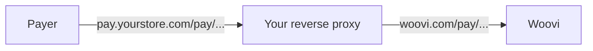

By default, a charge's payment link lives at `https://woovi.com/pay/{paymentLinkID}`.
If you want your customers to see an address with your brand, such as `https://pay.yourstore.com/pay/{paymentLinkID}`,
put a **reverse proxy on your own infrastructure** pointing to Woovi.

You don't need access to Woovi's infrastructure or any setting on the platform.
The payment page is still Woovi's; only the address changes.



Everything the payment page needs lives under the `/pay` path: the HTML, scripts, icons
and the API the page calls (`/pay/graphql`). So the proxy only needs to forward that path,
plus `/receipts` if you also want to serve receipts. The rest of your domain stays free.

## Prerequisites

- A domain or subdomain you own, for example `pay.yourstore.com`;
- A valid TLS certificate for that domain (Let's Encrypt, for example);
- A reverse proxy: nginx, Caddy, Traefik, Cloudflare, your cloud's load balancer, etc.

## Configuring the proxy

Whatever tool you use, the proxy must:

1. Forward `/pay/` and `/receipts/` to `https://woovi.com`, keeping the path and query string;
2. Send the `Host: woovi.com` header and use `woovi.com` as the TLS SNI. Without it, the request is rejected;
3. Accept `GET` and `POST` (the page sends `POST` to `/pay/graphql`);
4. **Not change or cache** the responses. The HTML holds the charge's QR Code and Pix Copy and Paste code.

### nginx

```nginx
server {
  listen 443 ssl http2;
  server_name pay.yourstore.com;

  ssl_certificate     /etc/ssl/pay.yourstore.com/fullchain.pem;
  ssl_certificate_key /etc/ssl/pay.yourstore.com/privkey.pem;

  # payment page, scripts, icons, the page's API and receipts
  location ~ ^/(pay|receipts)/ {
    proxy_pass https://woovi.com;
    proxy_ssl_server_name on;
    proxy_ssl_name woovi.com;

    proxy_set_header Host woovi.com;
    proxy_set_header X-Forwarded-Host $host;
    proxy_set_header X-Forwarded-For $proxy_add_x_forwarded_for;
    proxy_set_header X-Forwarded-Proto https;
  }
}
```

### Caddy

```caddy
pay.yourstore.com {
  @woovi path /pay/* /receipts/*
  reverse_proxy @woovi https://woovi.com {
    header_up Host woovi.com
  }
}
```

Caddy issues the TLS certificate automatically.

## Sending the link with your domain

The API still returns `paymentLinkUrl` with Woovi's domain. Build the link on your domain
from the `paymentLinkID`, which doesn't change:

```js
const MY_PAYMENT_DOMAIN = 'https://pay.yourstore.com';

const { charge } = await response.json(); // response of POST /api/v1/charge

const myPaymentLinkUrl = `${MY_PAYMENT_DOMAIN}/pay/${charge.paymentLinkID}`;
```

Receipts follow the same rule: `https://pay.yourstore.com/receipts/{paymentLinkID}`.

## Testing

1. Create a charge and copy its `paymentLinkID`;
2. Open `https://pay.yourstore.com/pay/{paymentLinkID}` in a browser. The amount, the QR Code and the button to copy the Pix code should show up;
3. Check that the page's API answers on your domain:

```bash
curl -s -X POST https://pay.yourstore.com/pay/graphql \
  -H 'content-type: application/json' \
  -d '{"query":"{ __typename }"}'
# {"data":{"__typename":"Query"}}
```

4. Pay the charge and watch the page switch to "paid" without reloading.

## Limitations

- **Real-time confirmation**: the page opens a WebSocket directly to `wss://woovi.com` to show the payment as confirmed.
  That connection doesn't go through your proxy and needs no setup. If your domain sets a Content Security Policy,
  allow `wss://woovi.com` in `connect-src`.
- **Images**: logos and images still load from `img.woovi.com`.
- **Previews**: when the link is shared on WhatsApp or social networks, the preview still points to `woovi.com`.
- **Woovi notifications**: emails and messages Woovi itself sends use `woovi.com/pay/...`.
  For the payer to receive only your domain's link, send the notification from your own system.
- **Look**: the page keeps Woovi's visual identity.
- **Volume**: all traffic reaches Woovi from your proxy's IP. If you expect heavy traffic, talk to our support before going to production.

## Security

The proxy sits between the payer and Woovi and can see and change the page, including the QR Code.
Treat it with the same care as your own website:

- Use HTTPS from the payer to the proxy and from the proxy to Woovi;
- Don't rewrite, inject into or cache the content Woovi returns;
- Restrict who can change the proxy configuration and the domain's DNS.
