### Pix Plugin for Magento2

## Summary

This document describes the steps needed to connect your Magento2-based e-commerce platform to Woovi. The Woovi platform reconciles your bank and your e-commerce in real time.
Once your Woovi account is connected, you can charge customers in real time with Pix QR Codes, send payment links and manage charges, including refunds.

> _Note: This document assumes you already have an active Magento2 environment._

> _Note: The plugin is listed as **OpenPix** on the Magento Marketplace, but it is the same Woovi plugin._

## 1. Install the Woovi plugin on your Magento2 instance

[OpenPix For Magento2](https://commercemarketplace.adobe.com/openpix-pix.html)

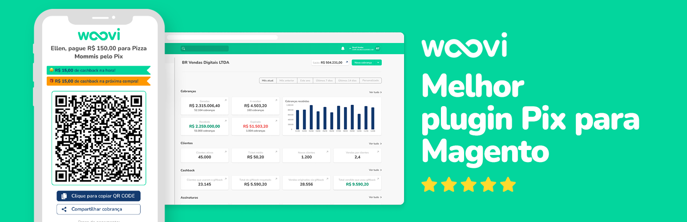
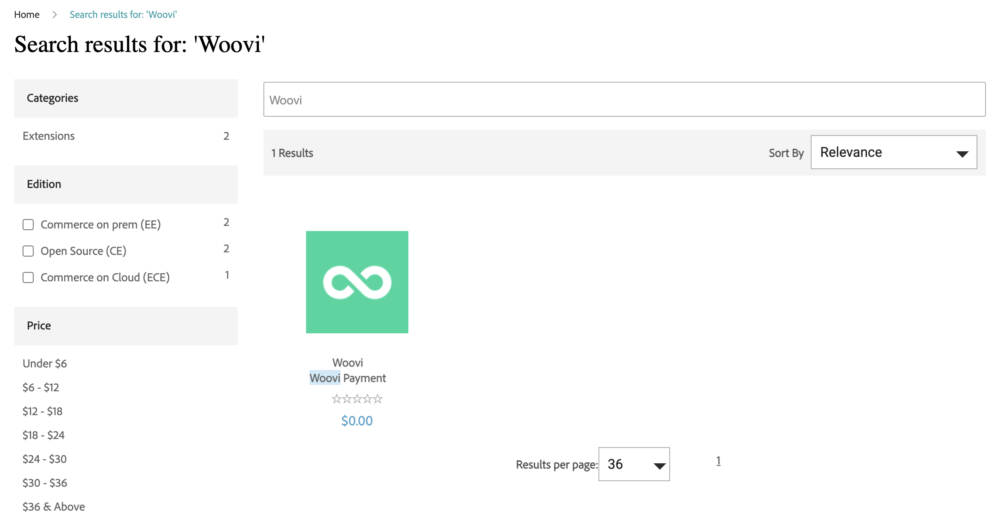

[Download Woovi Magento2 Plugin - version 3.0.4](pathname:///magento2/woovi_pix.3.0.4.zip) - Current version

## 2. Configuring the Magento2 plugin

1. Configure the Magento2 plugin in a single click by following the [Magento2 OneClick](/docs/ecommerce/magento2/magento2-oneclick) documentation

2. Enable the plugin by clicking `Payment via Pix` in the Woovi plugin.

- [ ] Enable or disable the plugin
- [ ] Customize the payment title shown in your store

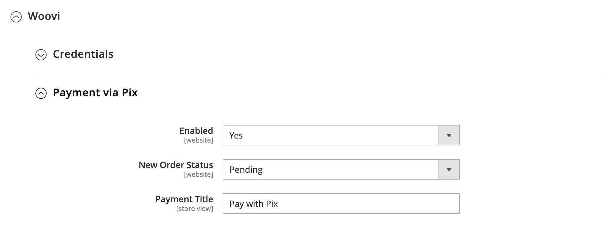

### 2.2 Configuring CPF/CNPJ for the customer (optional)

To save the order customer's CPF/CNPJ in your Woovi charge, you need to enable the `TaxVat` field in your Magento store.

**Note: if you continue without configuring this field, your charges will be saved without their customer.**

Go to Magento2 Admin -> Stores > Configuration -> Customers -> Customer Configuration

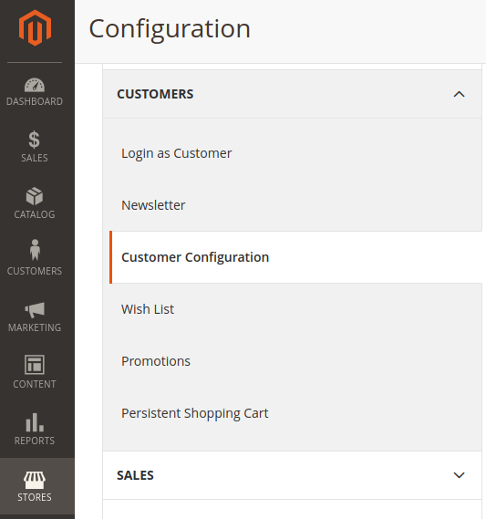

First, enable the `Show VAT Number on Storefront` field under `Create New Account Options`:

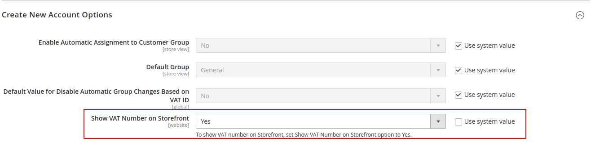

Then, under `Name and Address Options`, enable the `Show Tax/VAT Number` field:

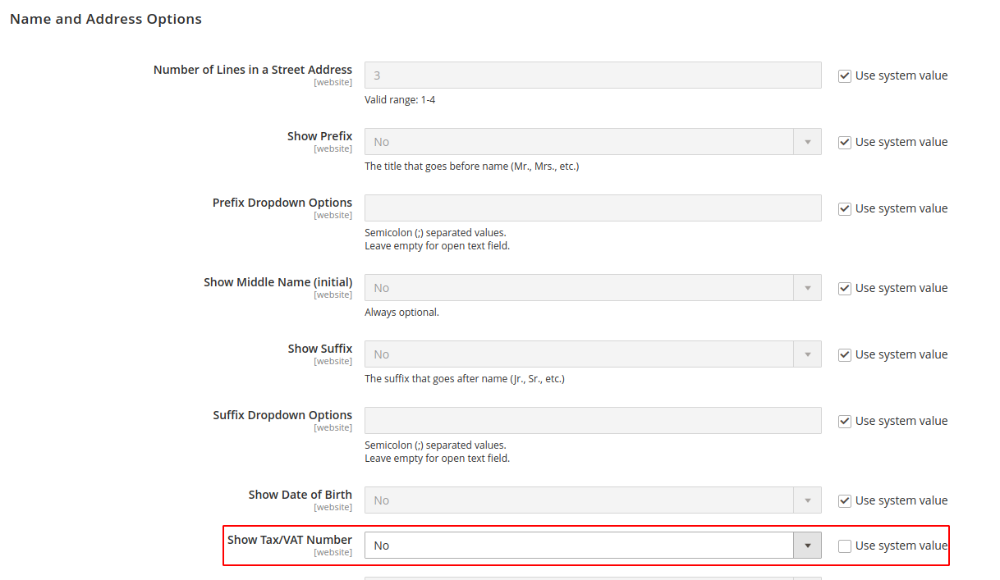

From now on, customers must fill in this field with their CPF or CNPJ, and it will be used to save the customer on the Woovi platform.

## 3. Create the webhook on the Woovi platform

After configuring the store, go back to the Woovi platform and register the webhook that will update your Magento2 store when a Pix charge is paid.

To register a new webhook, follow the steps below:

- Go to the Woovi platform and open: Admin -> API/Plugins -> `Novo Webhook` (New webhook)
- Use the same password registered in your Magento2 store. The webhook is required to update order status in real time when the Pix charge is paid.
- The callback URL to use in the registration is shown right below the field where you set the webhook password in your Magento2 store. The default is: [https://youstore.com.br/woovi/index/webhook](https://youstore.com.br/woovi/index/webhook)

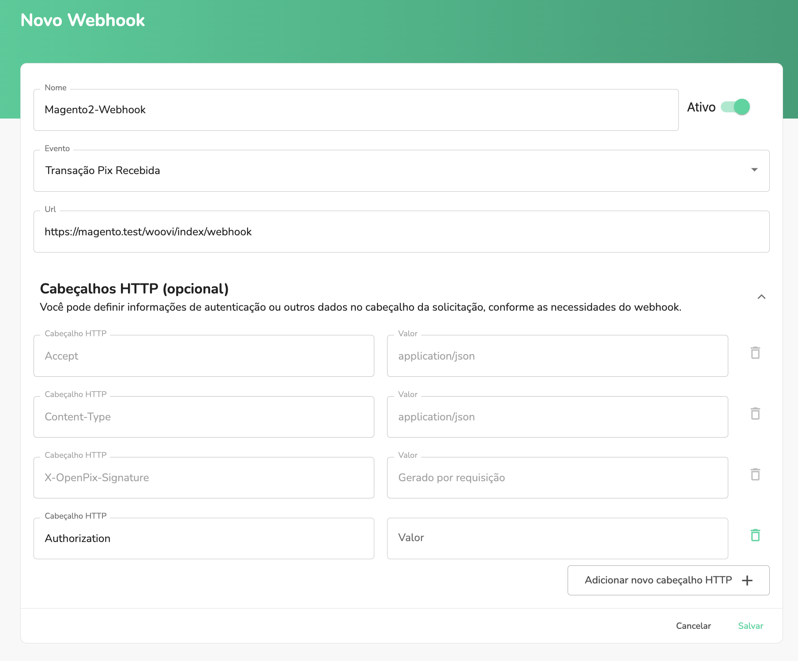

## 4. Place an order with Pix

Choose the option to pay the order using Woovi Parcelado

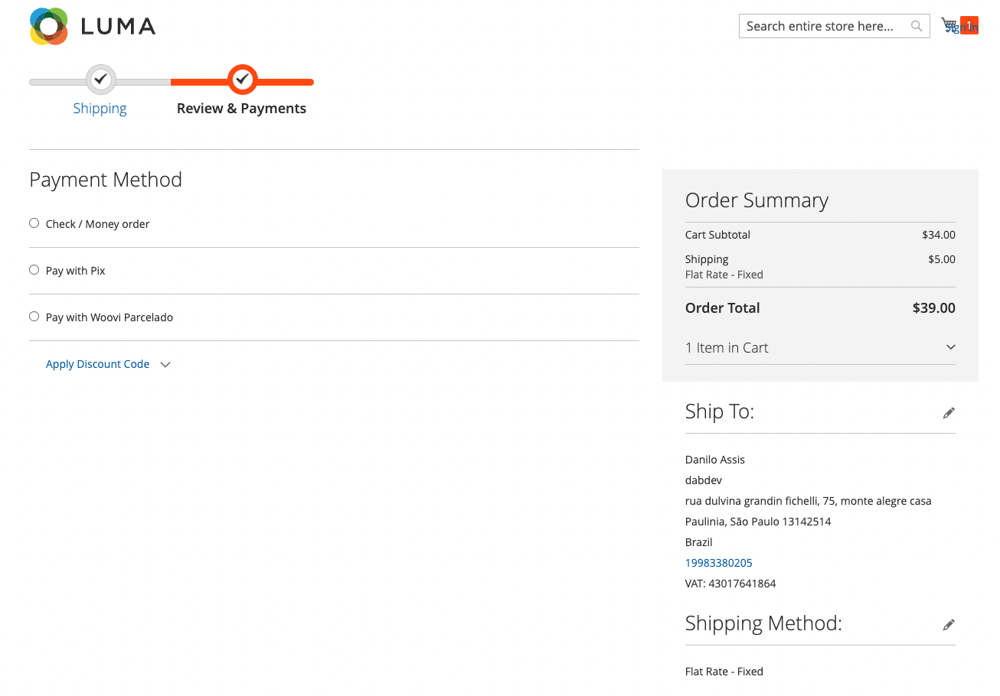

Pay the Pix using your bank app.

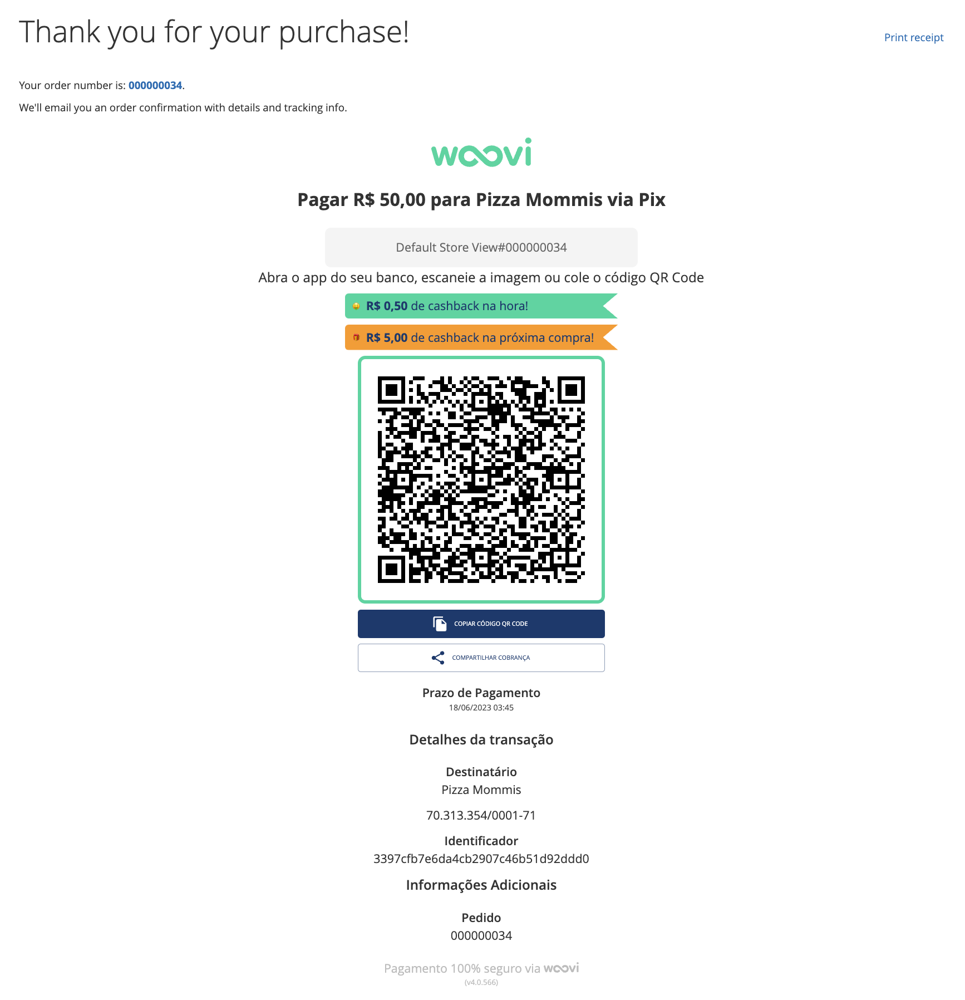

Check that the order status changed after payment

## 5. View an order paid with Pix

Your customer can view the order placed via Pix in the order details. They just click the button shown on the order detail page, "Clique aqui para ver seu QRCode" (Click here to see your QR Code)

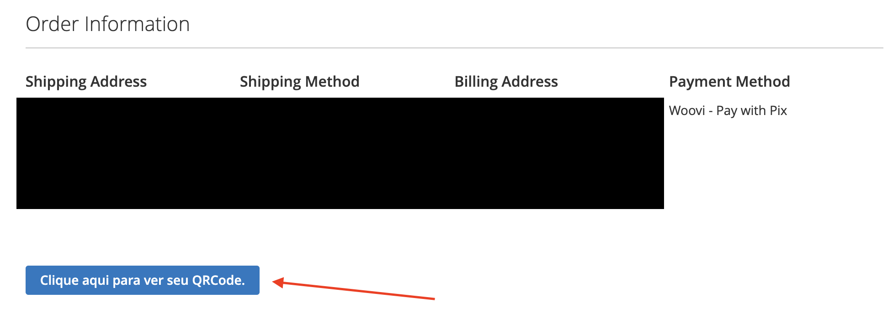
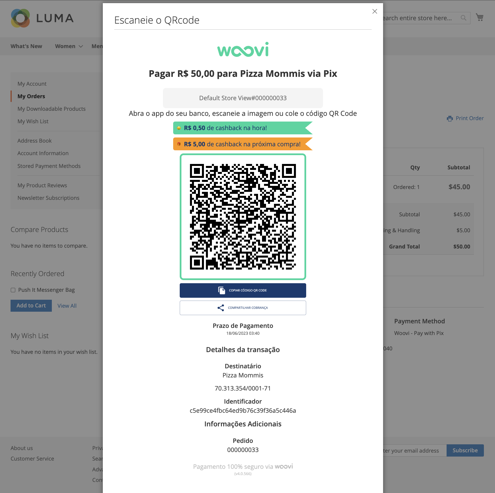

## Expiration

Woovi handles the expiration of the Pix charge. However, you must configure order expiration in your Magento store, since Magento handles the whole order process.

We recommend that order expiration/cancellation in Magento uses a time similar to the one configured in Woovi. Example:

- Woovi charge expiration time: 15 minutes
- set the same 15 minutes in your Magento store.

:::info
In Magento you can use the order lifetime setting by following the doc below:

- [https://docs.magento.com/user-guide/v2.3/sales/order-pending-payment-lifetime.html](https://docs.magento.com/user-guide/v2.3/sales/order-pending-payment-lifetime.html)
  :::

## Updating the plugin

We recommend that Woovi customers always keep the plugin on the latest version. You can find it in the installation step.

If your plugin is outdated, just follow the same installation step and update the plugin files in your e-commerce.

## Debug

To debug the Woovi plugin, there is a log file in `var/log`:

- `woovi.log`: logs for creating a new Magento order (and the corresponding charge on Woovi) and for updating the order when it is paid.
