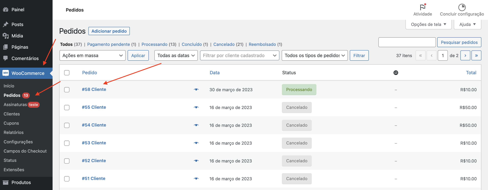
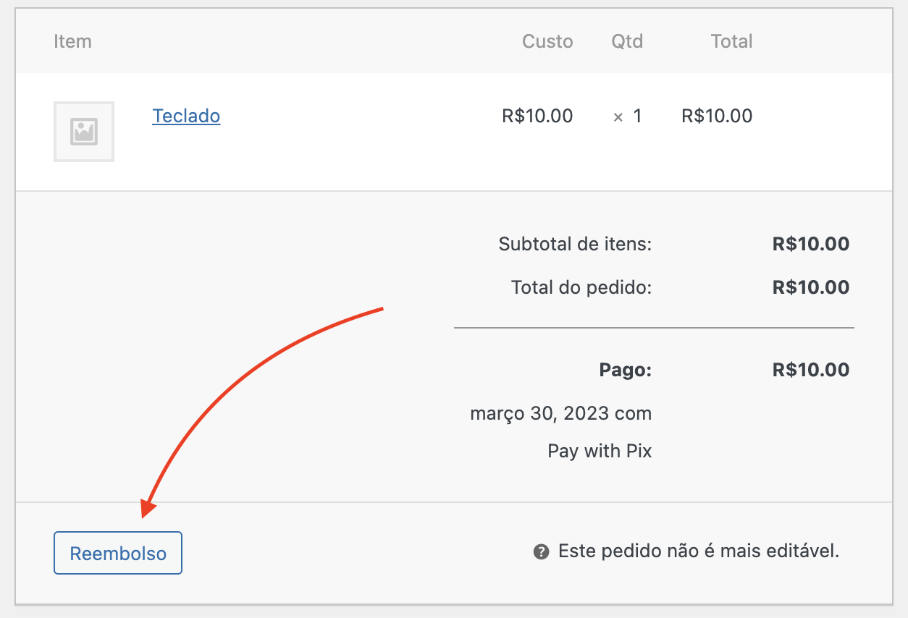
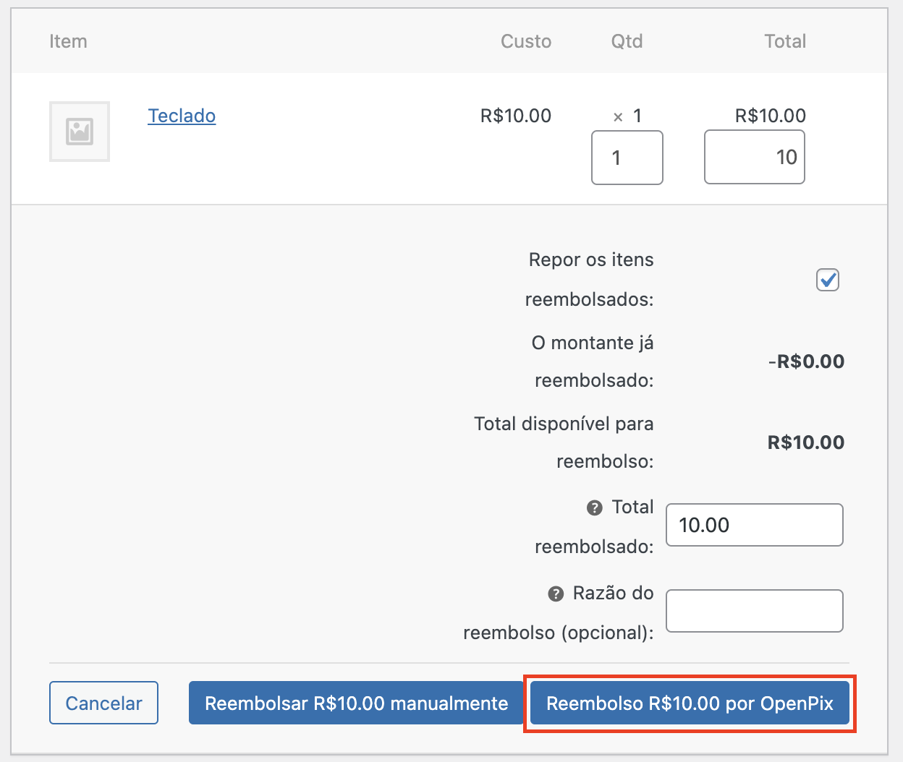
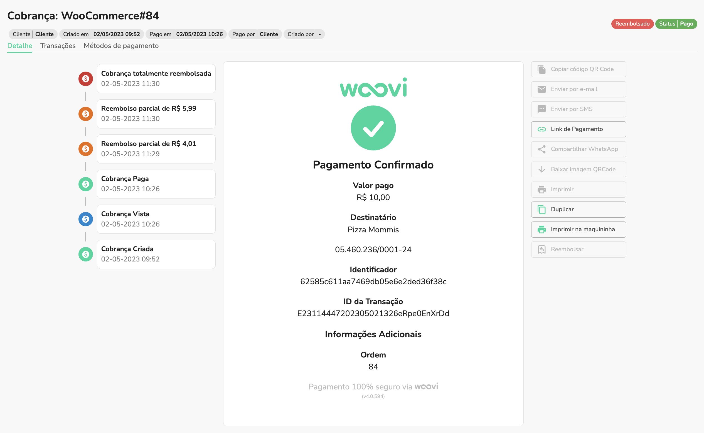
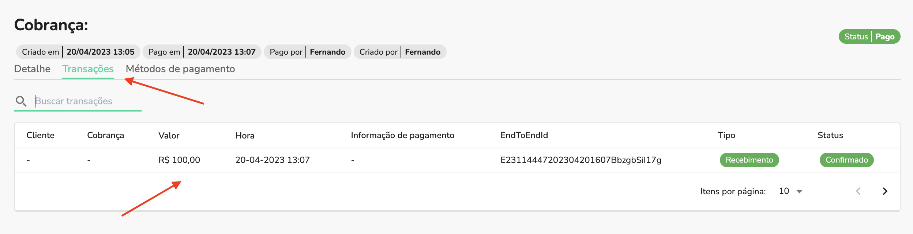
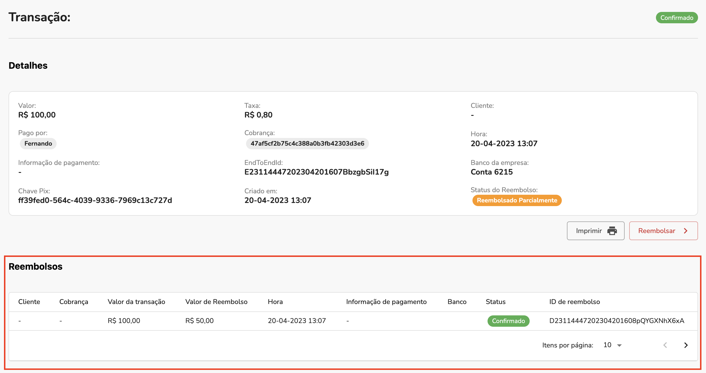

## 1. Open the order details

In the side menu, open the order list and then click on an order that has already been paid:

## 2. Click the refund button

A bit further down the page you will see a section with the order details. Click the **Refund** button:

## 3. Fill in the information and confirm the order

In this step you can configure how the refund will be made:

- In the **Qty** field, choose the quantity of items to be refunded
- Select **Restock refunded items** if you want the items to return to stock
- In **Total** you can set the total refund amount. It can be less than the order total, resulting in a partial refund.
- You can also add a comment for the refund in the **Reason for refund** field.

After completing the information, click the **Refund R$ XX,XX via woovi** button:

## 4. View the charge refunds on the platform

In the charge details on the platform you can see the refund status and events:

You can also view the list of refunds:

open the **Transactions** tab and select the payment transaction of the charge:

In the transaction details you can view all refunds:

