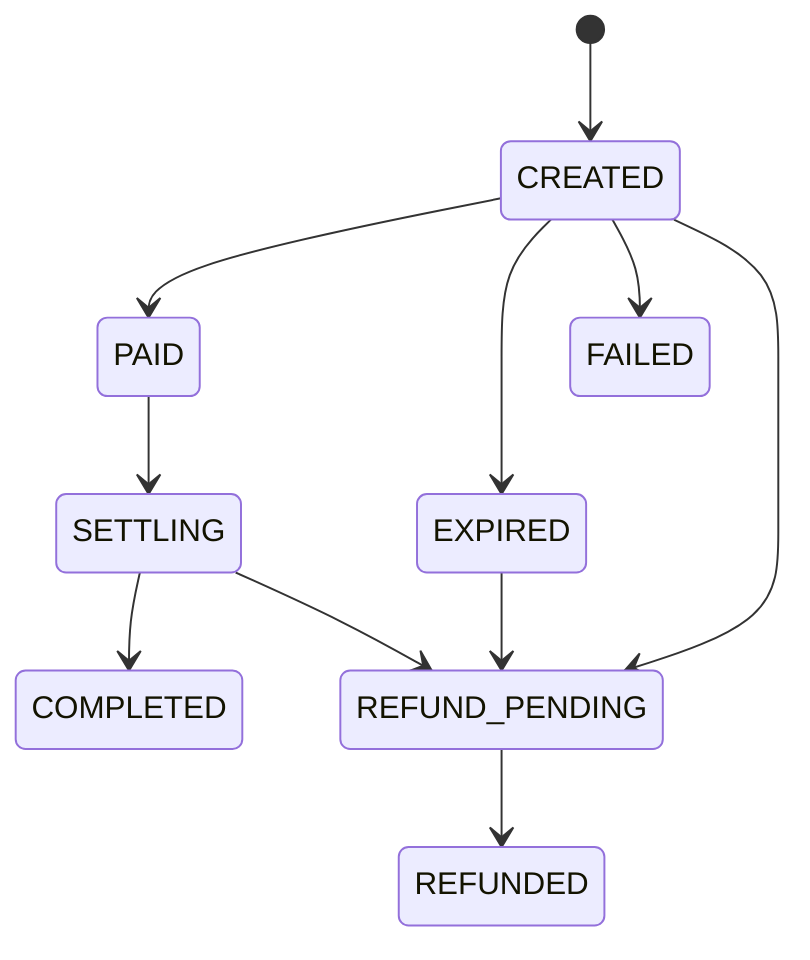

The flow has four steps:

1. **Quote** the total the payer will pay.
2. **Create the payment** (_payment-in_) and get the Pix QR Code.
3. **Show the Pix** to the payer.
4. **Check the status** until `COMPLETED`, when the amount has been settled into your CNR.

Before you start, check the [requirements](./efx-requirements.mdx). All amounts are **in centavos of real** (`50000` = R$ 500.00). The examples use fictitious data.

## 1. Quote

```bash
curl --request GET \
  --url 'https://api.woovi.com/api/v1/efx/quote?value=50000&currency=BRL&purpose=SERVICE_PURCHASE' \
  --header 'Authorization: <YOUR_APPID>'
```

Response `200`:

```json
{
  "quote": {
    "purpose": "SERVICE_PURCHASE",
    "value": 50000,
    "currency": "BRL",
    "iof": { "rate": 0, "value": 0 },
    "fee": { "value": 500 },
    "totalValue": 50500,
    "expiresAt": "2026-10-13T15:05:00.000Z"
  }
}
```

A quote **creates nothing**. Use `totalValue` to show the payer how much they will pay: the `value` that reaches your CNR, plus IOF (`iof.value`) and the Woovi fee (`fee.value`). Always use the values returned by the API, without recalculating on your side.

The quote's `expiresAt` tells until when it is valid as a reference. The price is only locked when you create the payment.

## 2. Create the payment

```bash
curl --request POST \
  --url https://api.woovi.com/api/v1/efx/payment-in \
  --header 'Authorization: <YOUR_APPID>' \
  --header 'Content-Type: application/json' \
  --data-raw '{
    "correlationID": "order-7f3a91",
    "value": 50000,
    "currency": "BRL",
    "purpose": "SERVICE_PURCHASE",
    "expectedTotalValue": 50500,
    "description": "Annual subscription",
    "expiresIn": 900,
    "payer": {
      "name": "Maria Silva",
      "taxID": "529.982.247-25",
      "email": "maria@example.com"
    },
    "beneficiary": {
      "name": "Example Payments Ltd.",
      "country": "US",
      "type": "COMPANY",
      "taxID": "12.345.678/0001-90",
      "bankAccount": {
        "ispb": "12345678",
        "branch": "0001",
        "accountNumber": "1234567",
        "accountType": "CHECKING"
      }
    },
    "invoice": {
      "number": "INV-2026-000123",
      "issuedAt": "2026-10-13T14:55:00.000Z",
      "url": "https://example.com/invoices/INV-2026-000123.pdf"
    }
  }'
```

- `beneficiary.bankAccount` is your CNR, registered at Woovi.
- `payer.taxID` is your customer's CPF or CNPJ. The Pix must come from an account in their name.
- `expectedTotalValue` is optional: if the total calculated at creation differs, nothing is created and the response is `409 quote changed: totalValue is now <value>`. Use it to make sure the payer pays exactly what you showed.

Every field is in the [API reference](./efx-api-reference.mdx#create-a-payment).

Response `201`:

```json
{
  "paymentIn": {
    "id": "6a0c3f2e9b1d4c0012ab34cd",
    "correlationID": "order-7f3a91",
    "status": "CREATED",
    "purpose": "SERVICE_PURCHASE",
    "value": 50000,
    "currency": "BRL",
    "iof": { "rate": 0, "value": 0 },
    "fee": { "value": 500 },
    "totalValue": 50500,
    "payer": { "name": "Maria Silva", "taxID": "52998224725" },
    "beneficiary": { "name": "Example Payments Ltd.", "country": "US" },
    "pix": {
      "brCode": "00020101021226...6304ABCD",
      "qrCodeImage": "https://.../qrcode.png",
      "paymentLinkUrl": "https://..."
    },
    "expiresAt": "2026-10-13T15:15:00.000Z",
    "createdAt": "2026-10-13T15:00:00.000Z"
  }
}
```

The Pix amount is the `totalValue`, locked at creation until `expiresAt`.

## 3. Show the Pix to the payer

Pick one:

- render the QR Code from `pix.brCode`, or offer it as Pix copy-and-paste;
- show the `pix.qrCodeImage` image;
- send the payer to `pix.paymentLinkUrl`.

Tell the payer the Pix must come from an account **in their own name**, with the same CPF or CNPJ you sent. A Pix paid by someone else is refunded, not settled.

## 4. Check the status

```bash
curl --request GET \
  --url https://api.woovi.com/api/v1/efx/payment-in/order-7f3a91 \
  --header 'Authorization: <YOUR_APPID>'
```

`:id` accepts the payment `id` or your `correlationID`. There are no eFX webhooks: query the payment (or the [list](./efx-api-reference.mdx#list-payments)) until a final status. The status does not change the instant the Pix is paid: confirmation and settlement are processed in the background.

```json
{
  "paymentIn": {
    "id": "6a0c3f2e9b1d4c0012ab34cd",
    "correlationID": "order-7f3a91",
    "status": "COMPLETED",
    "value": 50000,
    "totalValue": 50500,
    "paidAt": "2026-10-13T15:03:12.000Z",
    "endToEndId": "E12345678202610131503abcdef123456",
    "settledAt": "2026-10-13T15:05:01.000Z",
    "...": "..."
  }
}
```

## Statuses



| Status | Meaning | Final? |
| --- | --- | --- |
| `CREATED` | Pix created, waiting for payment. | no |
| `PAID` | Pix received and checked: payer, amount and deadline match. Settlement is about to start. | no |
| `SETTLING` | Transfer of `value` to your CNR in progress. | no |
| `COMPLETED` | `value` settled into your CNR (`settledAt`). | yes |
| `EXPIRED` | Nobody paid by `expiresAt`. | yes, unless a Pix is paid after the deadline (goes to `REFUND_PENDING`) |
| `REFUND_PENDING` | The Pix was received but must go back to the payer and will not be settled. The reason is in `refund.reason`. | no |
| `REFUNDED` | Refund completed. `refund.endToEndId` identifies the refund Pix. | yes |
| `FAILED` | The Pix could not be created. Create another payment with a new `correlationID`. | yes |

See the refund reasons in [Refunds](./efx-refunds.mdx).

## Idempotency with `correlationID`

A `correlationID` identifies **one** payment of your company.

- Repeating the `POST` with the same `correlationID` and the **same body** answers `200` with the same payment and the same Pix, without creating another. Field order does not matter, and `expectedTotalValue` is not part of the comparison.
- The same `correlationID` with a **different** body answers `409 correlationID already used with a different body`.
- If creation answers `502 could not create the Pix charge right now; retry with the same correlationID`, repeat the same `POST`: the payment already exists and Woovi tries to create the Pix again.
- If it answers `502 could not create the Pix charge; use a new correlationID to try again`, the payment is `FAILED`: create another one with a new `correlationID`.
