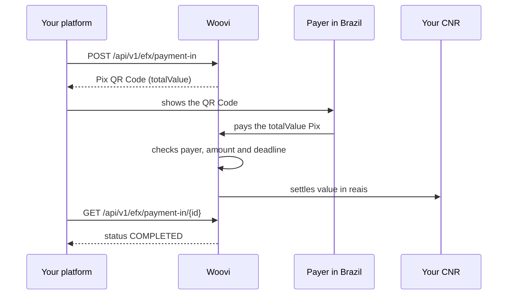

**Woovi eFX** is for international payment platforms (providers of international payment or transfer services, the eFX platforms) that need to receive payments from individuals and companies in Brazil.

Your customer in Brazil pays with **Pix**. Woovi checks the payment and settles the full amount, **in reais**, into your platform's **non-resident BRL account (CNR, _conta em reais de não residente_)**. You integrate a REST API: create the payment, show the Pix QR Code to the payer and follow the status until settlement.

## How the money flows

1. You send the operation amount (`value`), in centavos of real.
2. Woovi calculates the IOF tax and the Woovi fee and returns the total to pay (`totalValue = value + iof + fee`).
3. The payer pays the `totalValue` via Pix, from an account in their own name.
4. Woovi settles the **full** `value` into your CNR.

IOF and the fee are charged **on top** and paid by the payer. They are never deducted from what reaches your CNR: you receive exactly the `value` you sent when creating the payment.

## Currency

Settlement is currently **in reais (`BRL`) only**, into your CNR. The payment is created with `currency: "BRL"` and involves no currency conversion at Woovi.

## What is available

| Feature | Status |
| --- | --- |
| Quote (`GET /api/v1/efx/quote`) | Available |
| Pix collection (_pay-in_): create, get and list | Available |
| Sending payments to Brazil (_pay-out_) | **Not available yet** |
| eFX webhooks | Not available yet: follow the status by querying the API |

## Next steps

- [Requirements and rules](./efx-requirements.mdx): what you need before integrating and the Central Bank rules that apply to every operation.
- [Integration guide](./efx-getting-started.mdx): from quote to settlement, with examples.
- [API reference](./efx-api-reference.mdx): fields, statuses and errors of each route.
- [Refunds](./efx-refunds.mdx): what happens to Pix payments made by third parties, paid late or paid twice.
- [Central Bank reporting](./efx-regulatory-reporting.mdx): how each operation is reported to the Central Bank.
