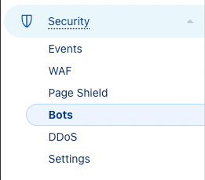
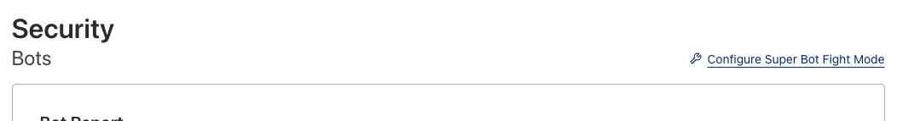
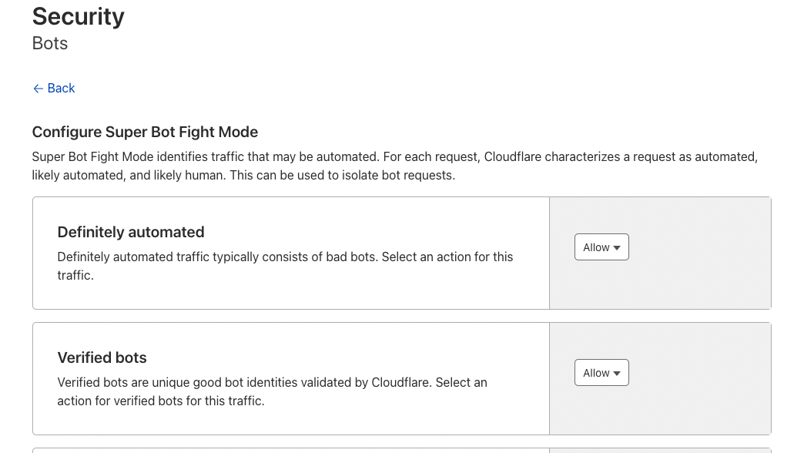

### I can't register my Webhook?

- Create a firewall exception rule
- If the rule doesn't work, disable the antibot protection

## Firewall exception rule

Example of a firewall exception rule:

## Disable Cloudflare Bot

Cloudflare's antibot solution may block Webhook requests.

To disable the antibot protection, follow the steps below:

1. click on your domain
2. In the sidebar, find Security and click it, then choose Bots in the menu:

4. In Bots, click `Configure Super Bot Fight Mode`

5. Find Definitely Automated and Verified Bots and set both to Allow

6. Run a test and check that it is working normally

[https://www.cloudflare.com/products/bot-management/](https://www.cloudflare.com/products/bot-management/)
