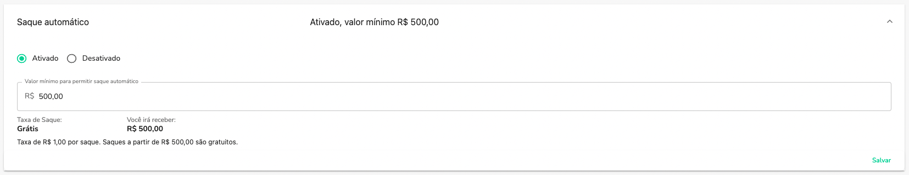

### What is a withdrawal?

Withdrawals are deposit transactions made between the virtual account and your CNPJ Pix key.

After making a withdrawal, you can freely move your company's money in the bank account linked to your CNPJ Pix key.

### How long does a withdrawal take to complete?

Withdrawals on the platform are instant via Pix, 24 hours a day, 7 days a week.

### How do I make a withdrawal?

1 - On the platform, click the `Contas` (Accounts) menu;

2 - Select the Woovi virtual account;

3- Click the `Sacar` (Withdraw) button;

All balance generated by charges is deposited automatically, every day at 7 PM, into the bank account linked to your CNPJ Pix key.

You can request a manual withdrawal at any time; in that case, if the withdrawal request is below R$ 500.00, a fee of R$ 1.00 per withdrawal will be charged.

### Automatic withdrawal

Automatic withdrawal is free for amounts equal to or greater than R$ 500 and is made every day at 7 PM.

:::info
The minimum withdrawal amount is configured in the transactional account settings on the platform. By default, this amount is R$ 500.00. Withdrawals above R$ 500.00 are free.
:::

### What are the withdrawal limits?

- Minimum withdrawal: R$ 1.01
- Maximum withdrawal: No limit

Withdrawals on the platform are instant via Pix, 24 hours a day, 7 days a week.

### Can I change my withdrawal Pix key?

No. For security reasons, withdrawals can only be made to your CNPJ Pix key; consequently, the amounts are deposited into the bank account your CNPJ Pix key is linked to.

### I made a withdrawal but the amount is not in my bank account?

Every withdrawal request is deposited to your company's CNPJ Pix key, and consequently into the bank account that key is linked to.

Check whether the bank account you looked at is the account where your CNPJ Pix key is registered.

You, or someone at your company, may have requested the change and the amount was deposited into another account.

If that is not the case, contact our support.

### Security Reserve

In accordance with Central Bank rules, we need to keep a percentage of the total balance as a security reserve for refunds in cases of fraud. Click here [https://www.bcb.gov.br/detalhenoticia/17417/nota](https://www.bcb.gov.br/detalhenoticia/17417/nota) to learn more.
