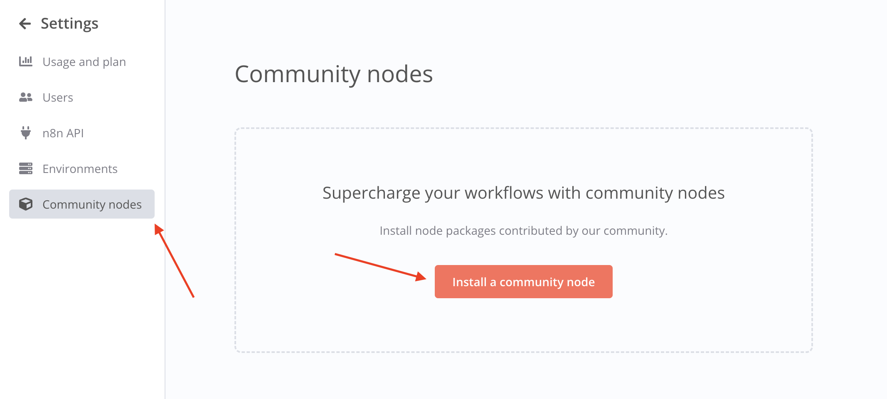
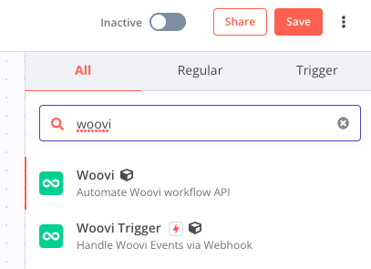

import Embed from 'react-embed';

## How to integrate the Pix Webhook with N8N

<Embed url="https://www.youtube.com/watch?v=Xss_AN1oz8U" />

## Documentation

1. Create an API on Woovi [here](../apis/api-getting-started.md#creating-new-api-key)
2. Copy the AppID
3. Open your N8N instance
4. Go to `Settings` > `Community nodes`
   4.1 Click `Install` and search for `n8n-nodes-woovi`
   

5. Create a new Workflow and use the `Woovi Trigger` node

