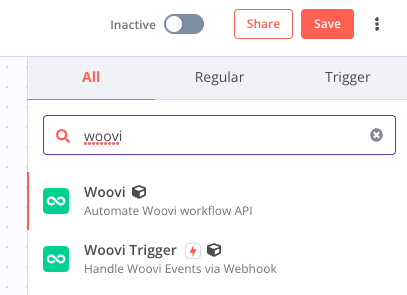

## What is N8N + Woovi?

N8N is a workflow automation tool that lets you connect various apps and services to build automated workflows. N8N is a free, open-source tool that can run locally or on a server.
Woovi is a payments and sales platform that lets you create automated charges, issue refunds, query transactions and much more, simply and quickly.

## How to install the Woovi node in N8N?

To find the Woovi node in N8N, you must:

1. Go to the settings tab
2. Click "Community Nodes"
3. Click install
4. Search for `n8n-nodes-woovi`

## What can you do with the Woovi node in N8N?

With the Woovi node you can:

- Create charges
- Search for charges (Request Access)
- Refund charges (Request Access)
- Make withdrawals (Request Access)

## How to configure the Woovi node in N8N?

First, inside N8N:

1. Click "Credentials"
2. Click Add Credential
3. Select the "Woovi API" credential type
4. Fill in the API Key field with your APP ID
   4.1. You can find your APP ID in the applications/plugins tab or create a new one ([documentation](../apis/api-getting-started))

## How to create a charge using N8N?

In your Workflow, you must:

1. Search for the Woovi node
   
2. Select the credential you created
3. Fill in the value field with the desired charge amount in cents
4. Fill in the description field with a unique correlationID for each charge
