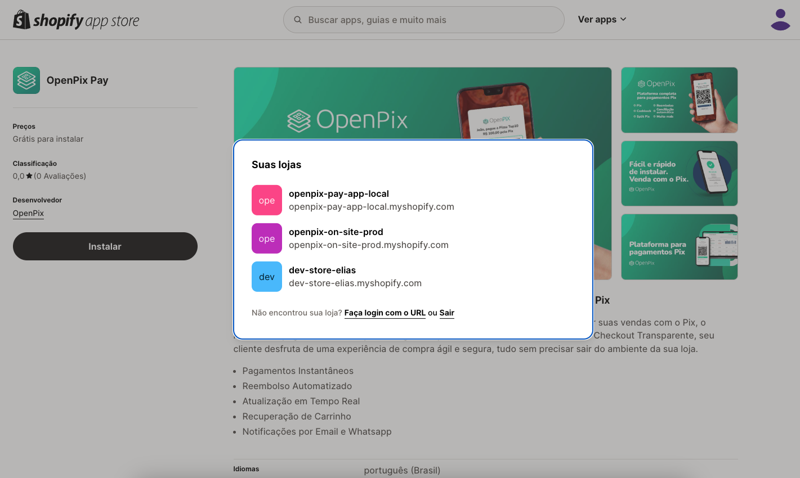
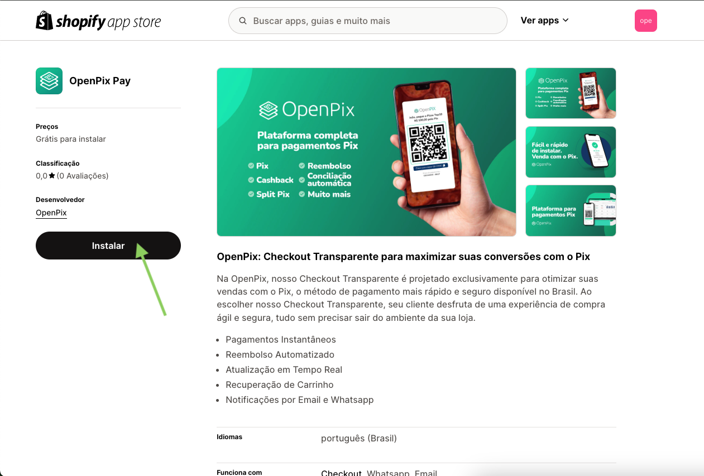
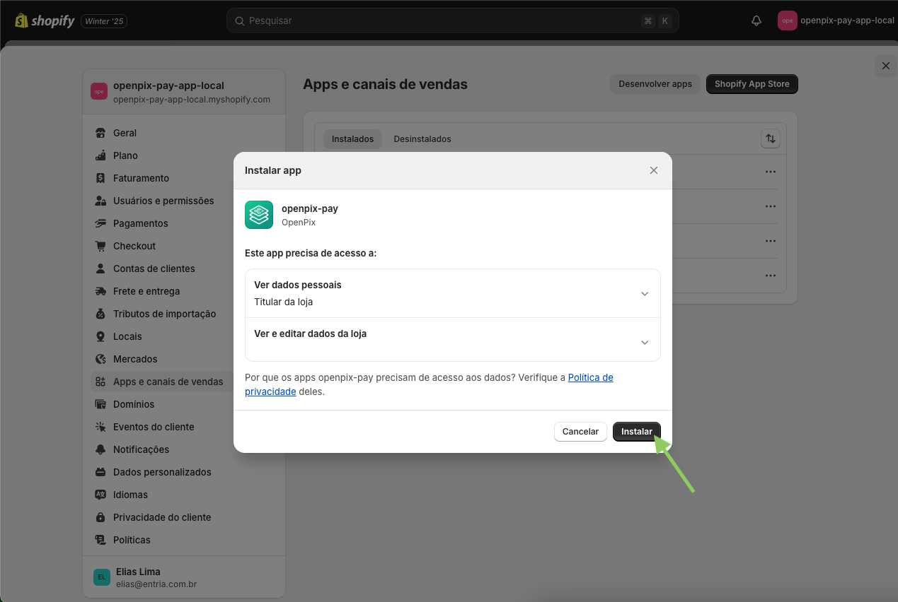
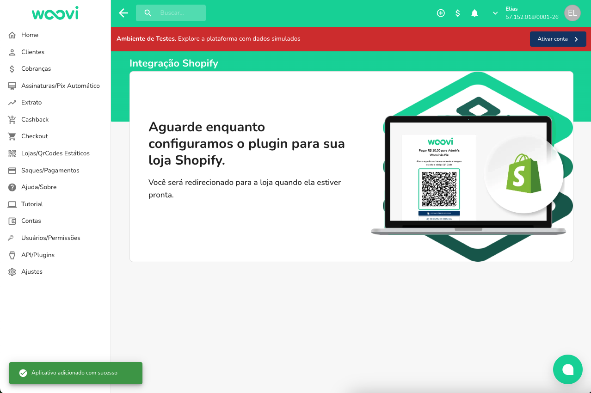
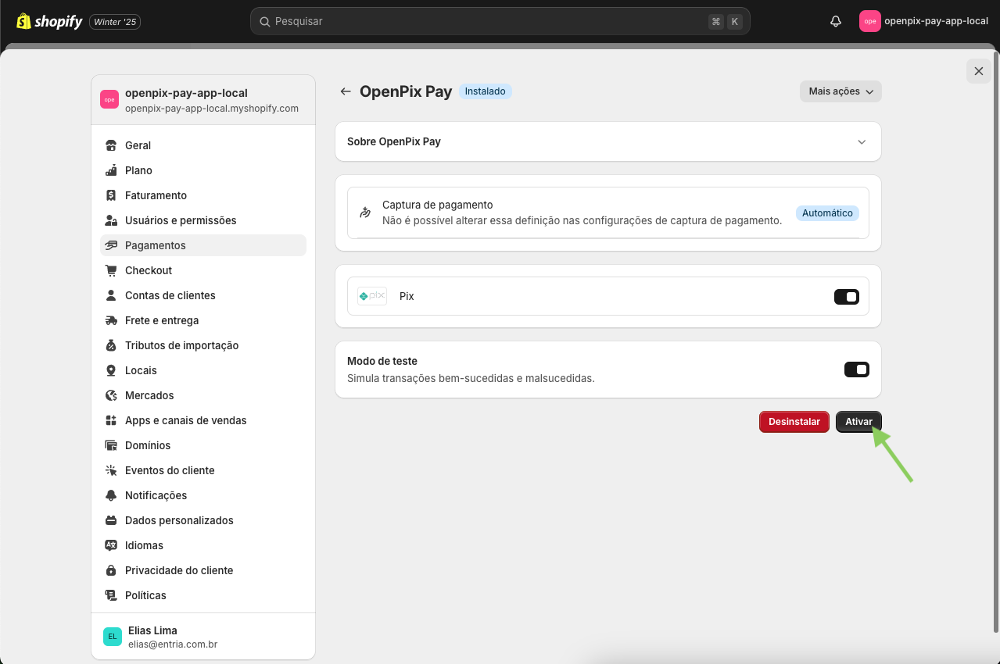
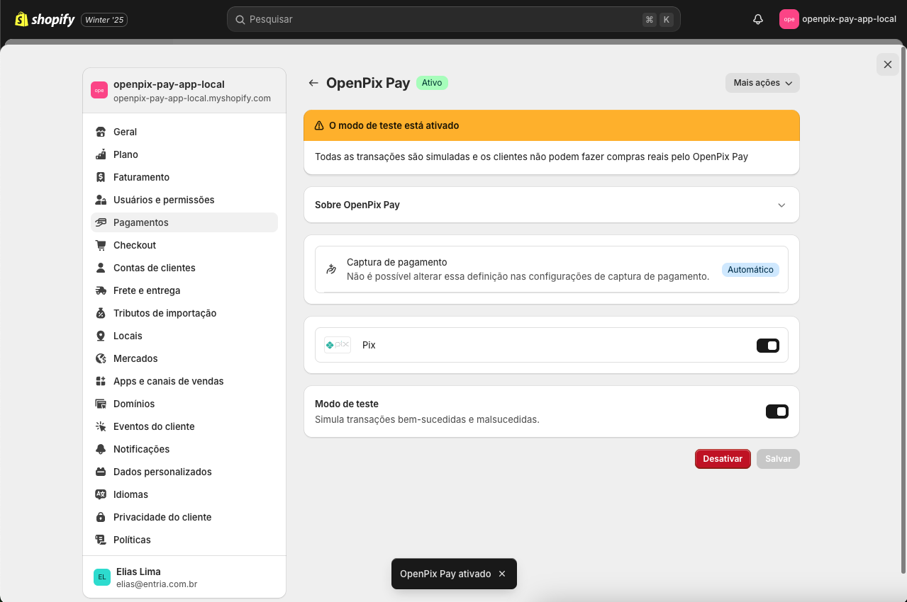

import Embed from 'react-embed';

:::caution

This documentation assumes you already have an active Shopify store and a Woovi account.

:::

## 1. Installing the Woovi app through Shopify

To integrate your Shopify store with Woovi, you need to install the OpenPix Pay app directly through Shopify. In the Shopify App Store, our app is still listed as OpenPix Pay.

- Open our app on Shopify: [OpenPix Pay](https://apps.shopify.com/openpix-pay-app-prod)

On the app's home page, select the store where you want to install the app:

After selecting the store, click Install:

Shopify will redirect you to the app installation panel.

Click the `Install` button again. You will be redirected to our platform, and the integration will happen automatically.

:::info

If you are not logged in to the platform, just complete the authentication and the installation flow will continue automatically.

:::

Once the integration on our platform is complete, you will be redirected back to Shopify to activate the app.

Just click Activate and you are ready to go.

:::info

We allow only one integration per store.

:::

## How the Shopify transparent Pix checkout works

<Embed url='https://www.youtube.com/watch?v=KunqUjHkgU4' />
