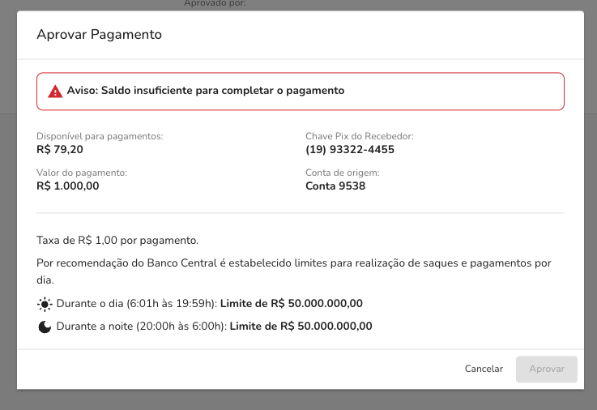

To make Payments from your company, follow the steps below:

## 1. Enable Payment Permissions on the Account

- Go to `Contas` (Accounts) via the side menu
- Click `Detalhes da Conta` (Account Details) on the account you want to make payments from
- Click the `Ajustes` (Settings) tab
- In the `Pagamentos` (Payments) section, enable the `Permitir que a conta possa realizar pagamentos` (Allow the account to make payments) option

## 2. Request a Payment

- Go to `Saques e Pagamentos` (Withdrawals and Payments) via the side menu
- Click `Solicitar Pagamento` (Request Payment)
- Fill in the fields

| Field                                         | Description                                          |
| --------------------------------------------- | ---------------------------------------------------- |
| Chave Pix do Recebedor (Recipient's Pix key)  | Pix key that will receive the payment                |
| Valor de Pagamento (Payment amount)           | total payment amount                                 |
| Comentário (Comment)                          | optional comment sent along with the payment         |
| Conta de origem (Source account)              | source account that will make the payment            |

- Click `Solicitar` (Request)

## 3. Approve a Payment

- Go to `Saques e Pagamentos` (Withdrawals and Payments) via the side menu
- Click the `Solicitações de Pagamentos` (Payment Requests) tab
- Click the request to be approved
- Click `Aprovar Pagamento` (Approve Payment)
- Check the information provided
- Click `Aprovar` (Approve)

## Insufficient balance when approving payments via the Platform
If you try to approve a payment via the platform without enough balance, a modal will be shown with the following information:

On the platform, the payment will remain in the requested status, and you can approve it once there is enough balance.
