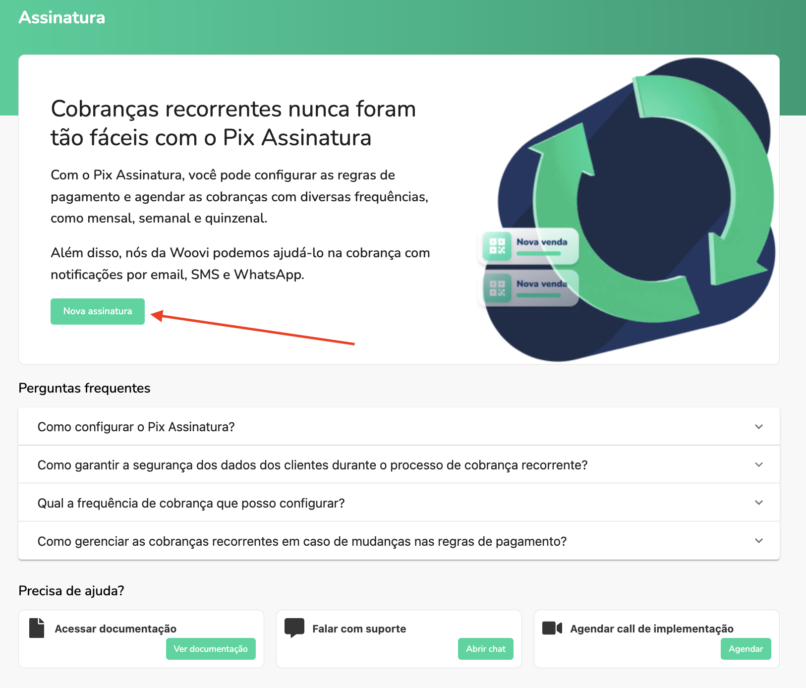
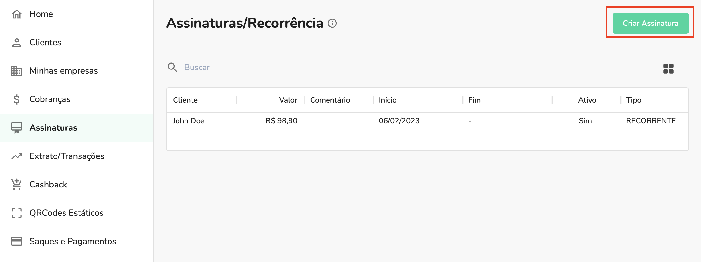
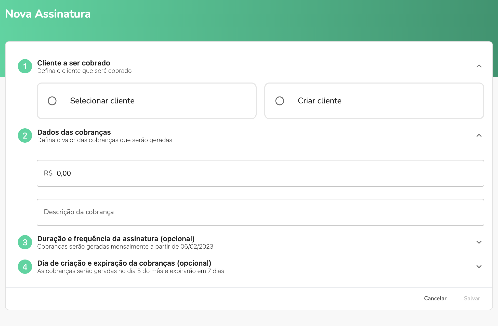
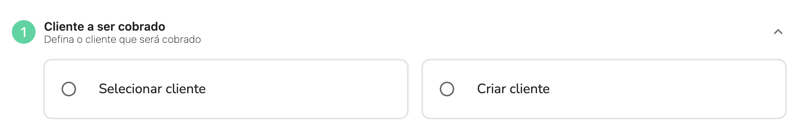
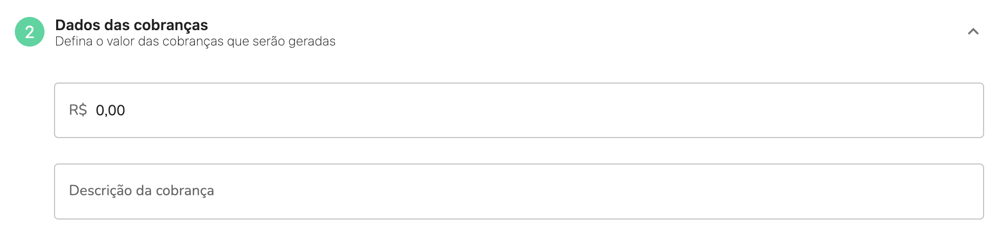
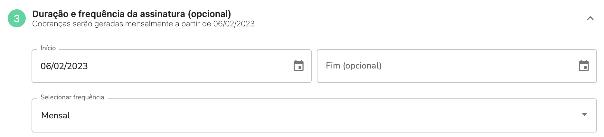
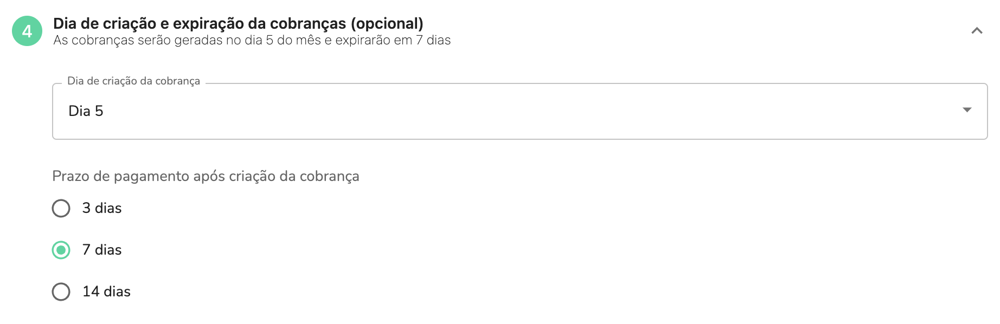
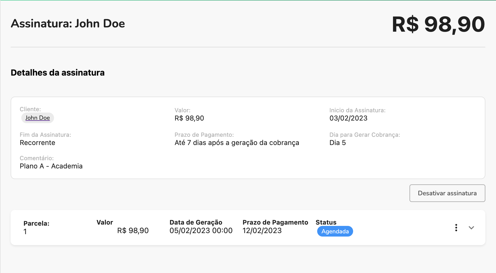

In this documentation we explain, step by step, how to create a Subscription.

## Creating your first subscription

To create your first Subscription, follow these steps:

1. Go to our platform [https://app.woovi.com/login](https://app.woovi.com/login)
2. Go to **Assinaturas** (Subscriptions) in the sidebar
3. You will see our tutorial; click the **Nova Assinatura** (New Subscription) button to open the form and create your first Subscription

## Creating new subscriptions

If you have already created a Subscription before, the list of subscriptions will be shown.

To create a new one, click the **Criar Assinatura** (Create Subscription) button.

## Form

You will then see our form for creating Subscriptions.

Below, we explain each step of this form and what each field means.

### Step 1: Customer to be charged

A customer is **required** to create a Subscription. You can add one by:

- Choosing a customer from your existing customer base
- Creating a new customer

### Step 2: Charge data

In this step you configure how the Subscription charges will be generated:

| Field                 | Description                                                  | Example                |
| --------------------- | ------------------------------------------------------------ | ---------------------- |
| Valor (Amount)        | Amount to be charged                                         | **R$ 98,90**           |
| Comentário (optional) | Comment that will appear on the QR Code at the time of payment | **Plano A - Academia** |

### Step 3: Subscription duration and frequency (optional)

In this step you configure the duration and frequency of the Subscription.

A Subscription may or may not have an end date.

- If it has one: all installments up to the end date will be scheduled, and the charges will be generated according to their dates.
- If it does not: one charge will be generated and the next one scheduled accordingly; these Subscriptions only end if they are deactivated.

| Field               | Default         | Description                    | Example        |
| ------------------- | --------------- | ------------------------------ | -------------- |
| Início (Start)      | _Current day_   | Subscription start date        | **06/02/2023** |
| Fim (End, optional) |                 | Subscription end date          | **25/12/2024** |
| Frequência          | Mensal (Monthly) | Subscription frequency        | **Mensal**     |

### Step 4: Charge creation day and expiration (optional)

In this step you configure the creation day and the payment deadline of the charges.

| Field                                  | Default | Description                                                         | Example    |
| -------------------------------------- | ------- | ------------------------------------------------------------------- | ---------- |
| Dia de criação (Creation day)          | Day 5   | Day of the month on which the charges will be generated             | **Dia 20** |
| Prazo de pagamento (Payment deadline)  | 7 days  | Time the customer has to pay after the charge is generated          | **3 dias** |

### Step 5: Save

After completing all the previous steps, just click the **Salvar** (Save) button and you will be redirected to the Subscription details:

